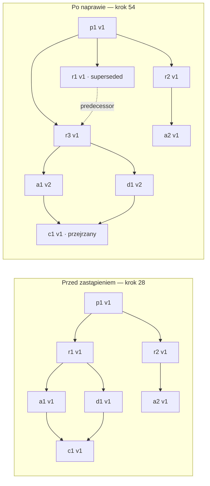

# WIT3 — zastąpienie wymagania i naprawa powiązań

Wykonano **54 kroki** na modelu **v0.6**, przyjętym przez DEC-PRO-009. Wydanie wraca z reviewed do in_preparation po zastąpieniu wymagania, a po naprawie zależności przechodzi ponowny przegląd i odbiór. [Raport rzeczywistego wykonania](report.md) pokazuje wszystkie kroki, warunki, dowody demonstracyjne i 17 wykrytych mutantów.

To symulacja reguł procesu. Nie zmienia produktów rzeczywistego projektu, nie zapisuje rzeczywistych zgód ani nie stanowi odbioru E2. Testy produktu i wynik przeglądu treści są danymi wejściowymi.

## Jak uruchomić i co zobaczyć

Z katalogu repozytorium:

```sh
uv run --locked --offline python scripts/run_scenario.py --scenario WIT3 --output artifacts/wit3
uv run --locked --offline pytest -q
uv run --locked --offline python scripts/check_model.py
```

Jeżeli zależności są już w `.venv`, można uruchomić `.venv/bin/python scripts/run_scenario.py --scenario WIT3 --output artifacts/wit3` i `.venv/bin/python -m pytest -q`. Nie wymaga to dostępu do pamięci pakietów uv. Pierwsze przygotowanie środowiska opisano w głównym README.

- `artifacts/wit3/report.md`: czytelny przebieg, wyniki kontroli i stan końcowy.
- `artifacts/wit3/trace.json`: pełne stany przed/po każdym kroku, wejścia, dowody, hashe modelu, scenariusza, kodu, lockfile i mutantów. Katalog jest ignorowany przez Git; wynik można odtworzyć.
- [Scenariusz](../../tests/fixtures/wit3/scenario.json) i [mutanty](../../mutants/wit3_gates.json): jawne dane eksperymentu; [testy](../../tests/test_replacement.py): niezależne oczekiwania i przypadki brzegowe.

## Co dzieje się po zmianie

| Kroki | Wynik |
|---|---|
| 1–28 | Siedem produktów w linii bazowej; wydanie reviewed. Rezerwowe r3 nadal none poza zakresem |
| 29–32 | Zgoda na T07(r1 v1), jej wykorzystanie, r1 superseded; a1/d1/c1 suspect; wydanie in_preparation |
| 33–36 | Utworzenie r3 z predecessor=r1, własna weryfikacja, zatwierdzenie U i linia bazowa |
| 37 | U przez W07 dodaje r3 do zakresu; r1 pozostaje w historii zakresu |
| 38–45 | Zgoda na T05(a1), otwarcie wersji 2, T14 zamienia r1 na r3; ponowna weryfikacja, zatwierdzenie i baza |
| 46–50 | T06 otwiera d1 v2; T14 naprawia powiązanie, T13 zamyka suspect po aktualizacji; weryfikacja i baza |
| 51 | Udokumentowany T11(c1): brak wpływu na kod po przeglądzie naprawionych zależności, c1 pozostaje v1 |
| 52–54 | Gotowość, ponowny przegląd R, odbiór U tego samego wydania 1 |

Krawędzie ciągłe oznaczają **podstawa → produkt zależny**. Linia przerywana to wyłącznie historyczne następstwo. Diagram objaśnia wynik; nie jest generatorem ani dowodem poprawności.



W praktyce operator widzi zakres wpływu zastąpienia wymagania: **a1, d1 i c1 trzeba przejrzeć; p1, r2 i a2 pozostają identyczne**. Agent wykonuje naprawę powiązań dopiero w otwartym szkicu i nie może sam dopisać następcy do wydania. Przegląd bez zmiany kodu jest świadomym założeniem tego scenariusza; program nie ocenia, czy treść kodu rzeczywiście pozostaje poprawna.

## Co sprawdzono

Całe repozytorium: **249 testów przechodzi**. Nowy przyrost obejmuje m.in. atomowość odrzuconych kroków, dojrzałość i typ następcy, jawne zgody/dowody, zachowanie innych krawędzi i wersji, propagację po bieżącym grafie oraz niezmienność historii. Wstrzyknięte stany w lokalnych testach cyklu, duplikatu czy pojedynczego warunku nie są świadkami osiągalności.

Wszystkie **17 mutantów WIT3** startują z rzeczywiście odtwarzanego prefiksu i ewentualnych kroków przygotowania. Uszkodzenia obejmują m.in. utworzenie następcy aktywnego produktu, błędny typ poprzednika, przepięcie bez otwarcia szkicu, niewłaściwego następcę lub zakres, pominięcie propagacji, nadpisanie predecessor, przedwczesny T11, W07 przez A, utratę starego ID i zmianę zakresu accepted. Wykrycie oznacza naruszenie wyroczni po wykonanym kroku mutanta, a nie błąd jego interpretacji. Łącznie pięć raportów WIT wykrywa 43 wybrane mutanty.

Poprzedni model v0.5 dopuszczał kontrprzykład S4: po T06(d1) można było skasować suspect z bazowego c1 przez T11, mimo że d1 było draft. Nowy guard to blokuje, a mutant przywracający stary warunek ponownie ujawnia błąd. Dla S6 jest osobna próba usunięcia suspect mimo zależności superseded — to inne naruszenie niż niedojrzała zależność.

Dodatkowy test po odbiorze wykonuje **56 kroków**: najpierw WIT1, potem zastąpienie r1, obowiązkowe W06 i pozostałą naprawę w wydaniu 2. Pełny rekord wydania 1, łącznie z zakresem, migawką i cytatem, pozostaje identyczny po każdym późniejszym kroku. Ten wariant jest testem uzupełniającym; raport główny opisuje 54-krokowy WIT3 przed odbiorem.

## Granice i następny przyrost

- Osiem ID, początkowy zakres siedem, najwyżej trzy pytania, trzy wersje i dwa wydania. Brak dowodu dla dowolnego rozmiaru projektu.
- Zgody i protokoły są demonstracyjne; narzędzie nie pobiera ani nie ocenia zgód rzeczywistego operatora.
- Pozostają pełne pokrycie przejść i właściwości E2, sekwencyjne badanie przez Hypothesis, kompletny raport mutacji i niezależny przegląd. Pięć poprawnych ścieżek nie dowodzi wszystkich możliwych przebiegów.
- W E3 pozostają TLC i wygenerowani świadkowie do przeglądu użytkownika; w E4 historia rzeczywistego projektu; w E5 włączenie do narzędzia pracy. DoD i kolejność etapów nie zostały skrócone.

[Przyjęta propozycja i historyczna diagnostyka v0.5](../../model/proposals/wit3-replacement.md) zachowują uzasadnienie zmiany. Źródłem obowiązującej semantyki jest [model](../../model/process.yaml).
