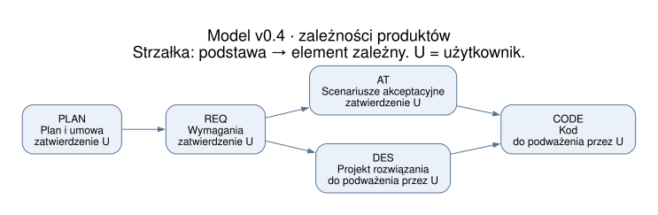
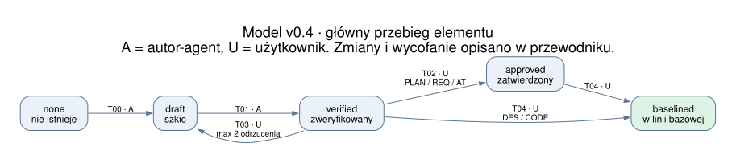
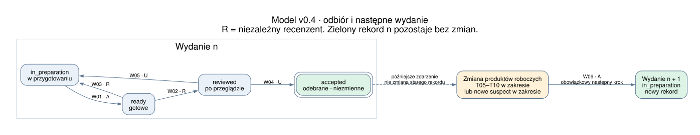

# Jak działa proces i co wspiera z Aneksu E

Migawka informacyjna z 2026-10-24 dla modelu v0.4 (DEC-PRO-006). Źródło wiążące: [process.yaml](../model/process.yaml). Diagramy pokazują zapisane reguły; nie są wynikiem wykonania symulatora ani dowodem właściwości.

## 1. Co powstaje i od czego zależy

Strzałki oznaczają zależności, nie obowiązek wykonania całego projektu w jednym przebiegu kaskadowym. Dla każdej nowej wersji element przechodzi właściwe bramki. PLAN obejmuje umowę i plan, REQ wymagania, AT scenariusze akceptacyjne, DES projekt rozwiązania, CODE kod.

T01 pozwala zweryfikować element, gdy jego bezpośrednie zależności są `approved` lub `baselined`, flaga `suspect` jest wyłączona i `checks_ok(e)` jest prawdziwe. Przykład: aby zweryfikować CODE, DES musi dojść do `baselined` — DES nie ma przejścia zatwierdzającego T02. AT może być `approved` lub `baselined`.

## 2. Jak dojrzewa pojedynczy element

- **A — autor-agent:** tworzy i weryfikuje element (T00/T01).
- **U — użytkownik:** zatwierdza PLAN/REQ/AT (T02), odrzuca propozycję (T03), wprowadza każdy typ elementu do linii bazowej (T04). T04 wymaga już bazowych zależności i braku `suspect`.
- **DES/CODE:** pomijają osobne zatwierdzenie T02; U może podważyć decyzję przez T06. T04 nadal jest krokiem U.

Na diagramie jest główna ścieżka. Pozostałe możliwości to otwarcie zmiany T05, podważenie T06, zastąpienie T07, wycofanie T08, odłożenie T09 i wznowienie T10. T05 wymaga rozstrzygniętego pytania. T05–T08 oznaczają elementy zależne jako `suspect`; T11 pozwala uznać brak wpływu, T12 zgłasza potrzebę zmiany, T13 poprawia podejrzany szkic. Ograniczenie T03 wynosi dwa odrzucenia bieżącej wersji.

Pytania mają osobny obieg: P00 tworzy `open`, P01 przedstawia jedno pytanie jako `asked`, P02 zapisuje jednoznaczną odpowiedź jako `resolved` i DEC. P03 po odpowiedzi niejednoznacznej wraca do `open`. P04/P05 pozwalają odkładać i wznawiać pytania; blokującego pytania nie można odłożyć. Kolejka daje pierwszeństwo pytaniom blokującym, a w obrębie priorytetu starszym.

## 3. Jak powstaje odebrane wydanie

W01 wymaga kompletności zakresu, przechodzących testów i braku otwartych lub zadanych pytań blokujących. Elementy przeznaczone do dostawy muszą być `baselined` bez `suspect`; odłożone, zastąpione i wycofane są zachowane w ewidencji zakresu, lecz wyłączone z dostawy.

**R — niezależny recenzent** przeprowadza W02/W03. W04 jest odbiorem przez U i utrwala numer wydania, zakres, migawkę produktów oraz protokół. U może też odmówić odbioru przez W05.

Po odbiorze zmiana produktów roboczych nie modyfikuje tego zapisu. T05–T10 w zakresie lub pojawienie się `suspect` w zakresie ustawia znacznik, który wymusza W06. Powstaje osobny rekord wydania n + 1; rekord n nadal jest `accepted`. Przerywana strzałka pokazuje późniejsze zdarzenie w pracy, nie zmianę stanu odebranego rekordu.

**Przykład WIT5:** wydanie 1 utrwala a2 w wersji 1 → U rozstrzyga zmianę → T05 tworzy roboczą wersję 2 a2 → A otwiera wydanie 2 przez W06 → weryfikacja, zatwierdzenie i linia bazowa a2 → przegląd R → odbiór U. W obu wydaniach pozostają różne, niezmienne migawki a2.

## 4. Pakiety z Aneksu E

[Aneks E, pozycje a–i](https://github.com/m1981/iso-29110-5-1/blob/main/chapters/annex-e-deployment-packages.md), wymienia dziewięć pakietów wdrożeniowych. Pakiet obejmuje praktyczne materiały, m.in. opisy, szablony, przykłady, listy kontrolne i narzędzia. Poniżej **ocena autora tej analizy**: powiązanie tematów z konkretnymi elementami modelu. Nie jest to audyt pełnych, osobno publikowanych pakietów ani deklaracja ich pełnego wdrożenia.

| Pakiet Aneksu E | Co wspiera model v0.4 | Czego model nie realizuje |
|---|---|---|
| a. Analiza wymagań | REQ i AT, zależność od PLAN, weryfikacja, zatwierdzenie, zmiany i oznaczanie zależnych: T00–T05, T07–T13 | Analizy treści, sprzeczności i kompletności wymagań; zawartość `checks_ok` jest założeniem |
| b. Architektura i projekt szczegółowy | DES zależny od REQ, weryfikacja, linia bazowa i podważenie decyzji agenta: T01/T04/T06 | Odrębnych modeli architektury, interfejsów, komponentów i oceny wariantów projektowych |
| c. Konstrukcja i testy jednostkowe | CODE zależny od DES i AT; `verified` oznacza przechodzące testy: T01, INT-006 | Wykonania kompilacji i testów, osobnych automatów przypadków testowych, pokrycia kodu i raportów testów jednostkowych |
| d. Integracja i testy | Bramka W01 z `tests_ok`, wymaganie bazowych elementów i brak blokujących pytań | Kolejności integracji komponentów, środowisk testowych, wykonania zestawów testowych i obiegu defektów |
| e. Weryfikacja i walidacja | Rozdzielenie A/U/R: T01, T02, T03, W02–W05; niezależny przegląd wydania i odbiór U | Zawartości kryteriów jakości i dowodów dla każdego produktu; R jest wymagany dla wydania, nie przy każdej weryfikacji elementu |
| f. Kontrola wersji | `version`, T04, kontrola zmian, `suspect`, migawki odebranych wydań i W06 | Rzeczywistych operacji Git, reguł gałęzi i scalania, kopii zapasowych, odzyskiwania i uprawnień do repozytorium |
| g. Zarządzanie projektem | PLAN, role U/A/R, kolejka pytań, DEC, bramki zmian i odbioru: P00–P05, T02/T05, W04 | Harmonogramu, szacowania kosztów i pracochłonności, zasobów, pomiarów postępu i szczegółowego rejestru ryzyk; PM.O5 ma powiązanie, ale treść ryzyk nie jest modelowana |
| h. Dostawa produktu | Gotowość, przegląd, odbiór i protokół numerowanego wydania: W01–W06 | Pakowania, dystrybucji, instalacji u klienta, szkoleń i oddzielnej kontroli instrukcji użytkownika, eksploatacji i utrzymania |
| i. Samoocena | Pośrednie wsparcie: G/S/L, mutanty i DoD pozwalają oceniać sam model; G6 sprawdza powiązania | Procedury samooceny całej organizacji lub projektu, kompletnej listy pytań, skali oceny i zbierania dowodów stosowania normy |

Najmocniej odwzorowana jest kontrola obiegu produktów, decyzji i wersji: tematy a, b, e i f. Tematy c/d występują głównie jako bramki oparte na założonych wynikach testów, g/h są odwzorowane częściowo, i ma wsparcie pośrednie. Żaden z tych opisów nie oznacza pełnego wdrożenia pakietu.

## 5. Co już działa w narzędziu

Po DEC-PRO-006 obecny zestaw ma **31 przechodzących testów**: wczytywanie, część walidacji strukturalnej, projekcja grafów, adnotacje ISO i wybrane mutanty. Nie ma jeszcze wykonawcy całego procesu ani interaktywnego symulatora. G2, wykonywanie warunków i skutków, niezmienniki bezpieczeństwa przez Hypothesis oraz dowody TLA+ pozostają do wykonania.

Diagramy SVG można powiększać; obok zapisano PNG. Generowanie z bieżącego YAML: `uv run --locked python scripts/render_process.py` (wymaga Graphviz `dot`). Do przyszłego symulatora przydatny będzie widok krokowy WIT1–WIT5 z wyborem aktora, stanami elementów, kolejką pytań i historią wydań; ten dokument nie wprowadza zmiany zakresu E2.
