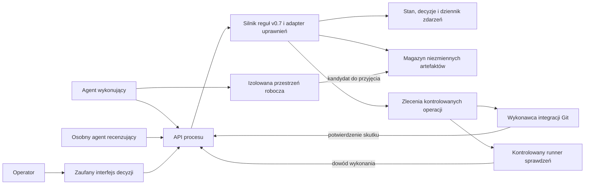

# Kontrakt API procesu dla zmiany zatwierdzonego wymagania — rewizja 2

Data: 2026-10-26. Autor: agent iso-model-state w roli architekta procesu, uprawnień i integracji. Status: **propozycja do przeglądu operatora**. Podstawa: model v0.7 / DEC-PRO-010, SHA-256 bajtów pliku process.yaml `2d329822e239555c1642d0a5a20aae0eb28fee17a6f2ff13968e48d7f428fc07`, baza repozytorium `2061c52`.

**Rekomendacja:** oddzielić wykonawcę od trwałego silnika procesu; chronić decyzje, stan procesu i migawki artefaktów. Agent przygotowuje pracę i dowody, operator decyduje, a silnik dopuszcza wyłącznie uprawnione operacje. API ma kontrolować przyjęcie wyniku do procesu, nie każdą roboczą edycję pliku.

Polecenie użytkownika „wejdz w role i wykonaj zgodnie ze sztuka i powyzszycmi zalozeniami” upoważnia do przygotowania tego kontraktu i niezależnego przeglądu. Nie jest akceptacją poniższych nowych zabezpieczeń ani poleceniem implementacji serwera. Model, DoD i kolejność E2–E5 pozostają wiążące. E2 nadal czeka na odbiór. Ten materiał stanowi przygotowanie architektoniczne do późniejszej integracji, bez rozpoczęcia E3–E5.

Rewizja 2 z 2026-10-26, baza `8d52b7b`: uzupełnienie po zgłoszeniu wyniku negatywnego znanego przed W04, lecz jeszcze niepodpiętego do procesu. Polecenie „wykonaj zgodnie z powyzsza rekomendacja” upoważnia do korekty propozycji i ponownego niezależnego przeglądu. [Pierwszy kontrakt](process-api-contract.md) i [jego recenzja](review.md) pozostają niezmiennymi zapisami historycznymi. Ustalenie R04 oraz aktualny werdykt: [przegląd rewizji 2](review-evidence-v2.md). To luka specyfikacji adaptera, nie wykazany błąd działającego API ani symulatora.

## 1. Scenariusz i obietnica systemu

Scenariusz: operator zmienia zatwierdzone, bazowe wymaganie `r1` z wersji 1 do 2 w przygotowywanym wydaniu. Agent proponuje doprecyzowanie treści; dla tego przykładu jawnie zakładamy, że po merytorycznym przeglądzie istniejące DES, AT i CODE nie wymagają zmiany treści. To hipoteza przykładu, a nie automatyczna ocena wpływu. Przypadek rzeczywistego wpływu musi uruchomić właściwe zmiany zależnych zamiast T11.

Punkt startowy pochodzi z WIT1 po W02: wydanie 1 `reviewed`; p1, r1, r2, a1, a2, d1, c1 są `baselined`, bez `suspect`; r3 jest `none`. Zależności: p1 → r1 → a1/d1 → c1 oraz p1 → r2 → a2. Nie ma pytań blokujących. Rejestr API dodatkowo przypisuje każdej wersji niezmienny manifest treści.

**Obietnica:** w chronionym serwisie agent nie zapisze decyzji U, nie przeprowadzi przejścia U, nie podmieni treści pod istniejącą akceptacją i nie odbierze wydania. Każdy przyjęty wynik ma tożsamość źródła oraz konkretny przedmiot. Obietnica obowiązuje pod warunkiem faktycznej izolacji poświadczeń i magazynów wskazanej w §2.

Poza obietnicą są: prawdziwość merytorycznej opinii, kompletność wymagań, trafność wszystkich testów, ochrona dowolnego pliku na komputerze operatora oraz automatyczna interpretacja swobodnego „tak”. Nie ma obietnicy ciągłego postępu przy niedostępnym operatorze, serwisie lub źródle dowodów.

## 2. Granice zaufania i zasoby



Strzałka z przestrzeni roboczej do magazynu oznacza import przez usługę, nie prawo zapisu agenta bezpośrednio do magazynu. Wdrożenie może być jednym serwisem; diagram rozdziela odpowiedzialności, nie narzuca mikroserwisów.

| Zasób | Kto może zmieniać | Miejsce egzekwowania | Granica gwarancji |
|---|---|---|---|
| Robocze pliki i lokalne commity | A w przypisanym obszarze | Izolacja wykonawcy | Roboczy commit nie oznacza T04 ani W04; lokalna kopia może odbiegać od stanu oficjalnego. |
| Oficjalne stany, decyzje, zależności i zakres | Silnik po autoryzowanym poleceniu | Transakcja usługi; brak dostępu A/R do bazy | A/R nie edytują reguł, ról, dziennika ani projekcji stanu. |
| Treść przyjęta do weryfikacji, bazy i odbioru | Importer tworzy nowy obiekt; brak nadpisywania | Magazyn i walidacja skrótu w API | Ścieżka lub URL podana przez A nie jest dowodem tożsamości treści. |
| Decyzja operatora | U przez zaufany interfejs | Osobna sesja U, kontrola celu i wersji | Cytat dostarczony przez A pozostaje deklaracją. |
| Chronione referencje Git | Dedykowany wykonawca według zlecenia | Uprawnienia repozytorium i warunkowa aktualizacja ref | Agent nie ma równoległego tokenu pozwalającego ominąć tę ochronę. |
| Wynik uruchomienia sprawdzeń | Runner dla przydzielonego zadania | Tożsamość runnera i powiązanie z manifestem | To dowód wykonania, nie dowód trafności testów. |
| Recenzja | Przydzielony R w oddzielnym przebiegu | Rejestr przydziału recenzji, nie pole `role` klienta | Osobny przebieg nie zapewnia braku skorelowanych błędów modeli. |

Zaufany rdzeń obejmuje usługę, magazyn, interfejs U, konfigurację uprawnień, importer oraz wykonawców chronionych operacji. Ich administrator nie jest objęty gwarancją odporności na agenta. Operator U też nie zmienia bezpośrednio bazy; administracyjne obejście procesu byłoby osobną, audytowaną procedurą poza tym kontraktem.

Poświadczenia U, runnera, recenzenta i integracji Git nie trafiają do środowiska A. Jeśli agent steruje przeglądarką zalogowanego operatora, czyta jego klucze albo ma ten sam nieograniczony dostęp systemowy co usługa, założenie niezaufanego wykonawcy nie jest spełnione. W takim środowisku wolno oferować wykrywanie rozbieżności, nie deklarować wymuszenia ochrony. Historycznego błędu polecenia z celem `/` ten serwis sam nie powstrzyma; wymaga on izolacji środowiska wykonawczego.

## 3. Tożsamość i macierz uprawnień

Tożsamość oraz role wynikają z uwierzytelnienia i przydziału do projektu. Pole `actor` klienta jest niedozwolone. Usługa zapisuje osobno uwierzytelnionego nadawcę, rolę modelową, identyfikator wykonawcy technicznego i dowód polecenia. Kontrole obejmują projekt i konkretny obiekt także dla odczytów oraz pobierania dowodów.

| Operacja | A | R | U | Mechanizm |
|---|---|---|---|---|
| Czytanie stanu i dowodów | Przypisany projekt | Przydzielony pakiet i potrzebne zależności | Własny projekt | Autoryzacja również pobrań i identyfikatorów |
| Przygotowanie propozycji i kandydatów | Tak | Ustalenia recenzji | Polecenia i uwagi | Nie tworzy decyzji ani bazowej wersji |
| P00 | Tak | Tak | Tak | Reguły modelu; dla change powiązanie zapisuje serwer |
| P01 | Tak | Nie | Nie | Jedno asked, kolejka z modelu |
| P02, P03, T02–T10, W04, W05, W07 | Nie | Nie | Tak, jeżeli model dopuszcza | Bramka U; nie wszystkie operacje należą do tego scenariusza |
| T00, T01, T11–T14, W01, W06 | Tak, według guard | Nie | Nie w roli U | Dane i dowody sprawdza adapter; stan zmienia silnik |
| W02, W03 | Nie dla autora ocenianej pracy | Tak dla przydzielonej recenzji | Nie | R składa ocenę; U odbiera przez W04 |
| Dowód runnera / potwierdzenie Git | Tylko deklaracja | Tylko deklaracja | Tylko deklaracja | Autorytatywny zapis wyłącznie od przypisanego wykonawcy |
| Zmiana polityki albo własnej roli | Nie | Nie | Poza tym API | Odrębne zarządzanie konfiguracją |

P04/P05 zachowują aktorów i ograniczenia modelu; nie są skrótem anulowania pytania change, które jest blocking. Agent nie może uzyskać roli R przez parametr ani sam sobie przydzielić recenzji. Zaufany mechanizm przydziału tworzy odrębny przebieg bez historii tworzenia i z pakietem do oceny; opinia pozostaje niepewna merytorycznie.

## 4. Zgodność z modelem i proponowane rozszerzenia

**M** oznacza obowiązującą regułę modelu. **A** oznacza proponowaną konkretyzację adaptera, która nie jest obecnie dowiedziona przez model ani zaakceptowana do implementacji. Żadna reguła A nie nadaje agentowi uprawnień U.

| Reguła | Status | Zastosowanie |
|---|---|---|
| P02 zapisuje zgodę/odmowę na określoną operację i wersję; T05 jest osobnym krokiem U | M, S1/S11 | Sama resolved ani cytat bez wiarygodnego pochodzenia nie wystarczają. |
| T05 zwiększa wersję, zużywa zgodę i oznacza zależnych suspect | M, S5/S11 | W jednym atomowym kroku modelu. |
| T11 wymaga dojrzałych zależności bez suspect | M, S4/S6 | Nie jest pozwoleniem na zmianę ich treści. |
| W01/W02/W04 zachowują warunki gotowości, R i U | M, S7–S8/S14 | Commit pośredni nie stanowi odbioru. |
| Zmiana po accepted wymusza W06 jako następne przejście; stary rekord pozostaje identyczny | M, S10 | Wariant po odbiorze wymaga dodatkowego kroku A; nie wykonuje go U. |
| AX01: uwierzytelnione role i odrębny kanał U | A | Usuwa możliwość zadeklarowania dowolnego aktora w zdarzeniu symulatora. |
| AX02: niezmienne manifesty treści, blokada podmiany poza draft | A | Domyka abstrakcję modelu, który nie zawiera treści produktów. |
| AX03: pochodzenie, aktualność i kompletność znanych dowodów oraz przydział R | A | Konkretyzuje zewnętrzne checks_ok/tests_ok i rolę R; §6.1 domyka także wiedzę przy W04. |
| AX04: rewizje procesu i wiedzy, trwałe ponowienia i rejestr zdarzeń | A | Konkretyzuje wykonanie równoległe i transport, w tym wspólny porządek przyjęcia dowodu i W04. |
| AX05: rozdzielenie zlecenia Git od skutku T04 i potwierdzenie integracji | A | Obsługuje częściową awarię poza atomowym modelem pamięciowym. |
| AX06: osobne potwierdzenie treści decyzji w zaufanym interfejsie | A | W tym wariancie nie polegamy na interpretacji swobodnej odpowiedzi przez A. |

AX01–AX06 są nowymi zobowiązaniami warstwy integracji. Ich przyjęcie wymaga osobnej decyzji oraz miejsca w planie. Nie deklarujemy, że 389 testów E2 już je sprawdza. Limit eksploracji max_questions/max_releases nie staje się limitem użytkowym API. MAX_REJECTIONS pozostaje regułą modelu; jej zmiana wymaga decyzji, nie konfiguracji ad hoc wykonawcy.

## 5. Przebieg od propozycji do odbioru

| Krok | Polecenie i nadawca | Skutek i dowód |
|---|---|---|
| 1 | A przygotowuje propozycję i P00(change, r1, T05), następnie P01 | Serwer wiąże q1 z r1 v1 oraz zapisuje niezmienny opis celu zmiany. Nie podmienia jeszcze r1. |
| 2 | U wybiera „Zgadzam się i polecam otworzyć zmianę” | Jawnie zamówiona sekwencja P02(approved) i T05, oba z aktorem U. Zgoda q1 zużyta, r1 v2 draft, a1/d1/c1 suspect, wydanie in_preparation. |
| 3 | A dostarcza nową treść r1 v2 | Importer sprawdza i utrwala manifest kandydata. To techniczna edycja draft, bez nowego przejścia modelowego. |
| 4 | Runner dostarcza sprawdzenia, A żąda T01(r1) | Adapter wyznacza checks_ok dla konkretnego kandydata i zależności; p1 baselined. Kandydat zostaje zamrożony jako verified. |
| 5 | U zatwierdza treść T02 i osobno poleca ustalić bazę T04 | Możliwe jedno świadome potwierdzenie obu wymienionych działań. T02 nie oznacza T04 bez tego polecenia. T04 czeka na potwierdzony commit lub tag dokładnie tej treści (§8). |
| 6 | A przegląda a1 i d1, następnie c1; żąda T11 dla każdego | Wpisy „brak wpływu” odnoszą się do r1 v2 i odpowiednich manifestów. a1/d1/c1 zachowują wersje i treści. c1 dopiero po usunięciu suspect z a1/d1. |
| 7 | Runner sprawdza pełny kandydat wydania; A żąda W01 | tests_ok pochodzi z wyniku dla aktualnego manifestu całego zakresu. Silnik sprawdza również kompletność i pytania. |
| 8 | Przydzielony R wykonuje przegląd i W02 albo W03 | Raport związany z manifestem, wersją polityki i stanem zależności. Przy W03 powstają pytania blocking zgodnie z modelem. |
| 9 | U wykonuje W04 albo W05 | W04 ponownie sprawdza pytania, tożsamość przedmiotu przeglądu i pełną wiedzę dowodową (§6.1), po czym atomowo zapisuje niezmienny odbiór. W05 nie wymaga zgody A/R. |

P02+T05 można wykonać w jednej lokalnej transakcji jako dwa uporządkowane zdarzenia modelowe. Interfejs pokazuje oba działania przed potwierdzeniem; błąd drugiego oznacza rollback całego pakietu. T05 nie zatwierdza treści r1 v2. Jeśli operator wybierze wyłącznie P02, T05 wymaga jego kolejnego polecenia; A nie może wykorzystać samego approved jako własnego uprawnienia.

Wariant odmowy: P02(rejected) kończy pytanie, T05 jest niedozwolone, wersja r1 nie zmienia się. Odpowiedź niejednoznaczna nie tworzy zgody; P03 zachowuje semantykę modelu. W bazowym interfejsie przyciski wiążą decyzję z jednym asked, a swobodny komentarz pozostaje komentarzem. Automatyczna interpretacja czatu jest poza tym wariantem.

Jeśli przegląd wykaże wpływ na zatwierdzone AT lub bazowe DES/CODE, A nie może użyć T11 jako zamiennika poprawki. Zgłasza właściwe pytania i przechodzi T05 dla objętych zmianą produktów, z bramkami U oraz kolejką S9. Nie przypisujemy rzeczywiście jednoczesnym historycznym pytaniom fikcyjnej sekwencji.

## 6. Dane i niezmienność

Każdy projekt ma `process_revision` zwiększaną przez przyjętą transakcję zmieniającą stan modelu, bieżącą treść szkicu lub aktywne powiązania dowodów, oraz `policy_digest` identyfikujący model i konfigurację adaptera. Przebieg nie przełącza polityki automatycznie. Rekordy historyczne zachowują użyte wersje polityki.

Zadania i rezerwacje mają osobną `operation_revision`; ich zapis sam nie zmienia `process_revision`. Projekt ma dodatkowo monotoniczną `evidence_revision`: trwałe przyjęcie nowego autorytatywnego wyniku oraz zmiana stanu zlecenia istotnego dla bramki zwiększają ją atomowo z zapisem faktu. Utworzenie takiego zlecenia też ją zwiększa. Każda dalsza zmiana wiedzy używanej w ocenie — uzupełnienie logu lub metadanych, wynik klasyfikacji, ustalenie konfliktu — zwiększa evidence_revision w tym samym wspólnym porządku zapisu. Kolejne oceny dopisują rekordy; nie nadpisują dowodu ani historycznego AcceptanceCheck. Odpowiedź runnera jest przyjmowana także przy starszej process_revision lub operation_revision: nie wolno zgubić prawidłowo przypisanego wyniku z powodu zmiany statusu zadania. Numer próby i przydział identyfikują pochodzenie, a nie prawo ukrycia późnego wyniku. Deduplikacja nie zwiększa rewizji; zmiana wyniku pod tym samym callback_id jest konfliktem i tworzy nierozstrzygnięte ustalenie o integralności źródła, widoczne dla bramki.

Powiązanie dowodu z procesem nadal wymaga polecenia procesowego, ale **uwzględnienie go przy decyzji nie zależy od tego powiązania**. Callback nie zmienia sam stanów modelu ani tests_ok. Rozdzielenie rewizji pozwala przyjąć dowód podczas rezerwacji T04 bez zmiany chronionej process_revision; nowa wiedza nadal podlega §6.1.

| Rekord | Minimalna treść | Reguła |
|---|---|---|
| `Proposal` | project_id, item_id, item_version, operation, opis, base_manifest_digest, proposal_digest | Serwer wyznacza skróty; edycja tworzy nową propozycję. |
| `OperatorDecision` | principal_id, decision_view_id, subject_kind, subject_digest, ordered_commands, quote/etykieta wyboru, process_revision, czas serwera, przy W04 acceptance_check_id; proposal_digest tylko dla przedmiotu change | Tworzony w kanale U; brak możliwości importu jako decyzji z tokenem A. |
| `ArtifactManifest` | repo_id, commit_id lub obiekty, item_id, item_version, content_revision, skróty treści, historyczny kontekst powstania | Serwer czyta bajty i sprawdza odwołania; sam hash od A jest deklaracją. |
| `AssessmentContext` | item manifest, bieżące ID/wersje/manifesty zależności, policy_digest, authenticated_author, cause_decision_id, cause_event_id, rationale, evidence_refs | Nowy rekord oceny związany z DEC wywołującą zmianę i uwierzytelnionym A; nie zmienia historycznego ArtifactManifest. |
| `DecisionView` | principal_id U, subject_kind, przedmiot i jego digest, process_revision, ordered_commands, nonce; dla W04 evidence_revision i acceptance_check_id | Serwer tworzy widok konkretnej decyzji; A nie dostarcza jego treści jako autorytatywnej. |
| `Evidence` | evidence_id, callback_id, job_id, attempt_id, producer_id, material_digest, manifest_digest, check_plan_digest, environment_digest, wynik, log_digest, received_sequence | Status deklarowany przez A oddzielony od wyniku runnera. |
| `AcceptanceCheck` | release_id, release_manifest_digest, material_digest, review_id, process_revision, evidence_revision, policy_digest, ocenione evidence_ids i job_ids, klasyfikacje z uzasadnieniem, wynik | Niezmienna migawka oceny pełnej wiedzy; nie tylko lista dowodów wybranych przez A. |
| `EvidenceFinding` | finding_id, evidence_ids, release_id/material_digest, przyczyna, received_sequence | Dopisywane ustalenie adaptera, także po odbiorze; nie jest samoczynnym P00, W05 ani zmianą accepted. |
| `Review` | assignment_id, reviewer_principal, run_id, manifest_digest, findings, wynik | Autor ocenianego przyrostu nie wystawia własnego W02. |
| `Operation` | operation_id, principal_id, command_digest, expected_revision, operation_revision, attempt_id, status, result/event_ids | Umożliwia rozstrzygnięcie utraconej odpowiedzi bez powtórzenia skutku. |
| `ProcessEvent` | event_id, sequence, policy_digest, actor, authenticated_principal, command_id, before/after revision, evidence_refs | Dopisywany atomowo ze stanem; A/R nie mogą edytować historii. |

`item.version` pochodzi z modelu; `content_revision` jest techniczną rewizją szkicu. Zmiana szkicu nie zwiększa samodzielnie wersji modelowej. Po T01 treść jest zamrożona; kolejne bajty wymagają legalnego powrotu do draft. T03 może wrócić do draft w tej samej wersji, lecz zmiana content_revision unieważnia stare powiązania dowodowe. `approved` i `baselined` nigdy nie wskazują podmienionych bajtów. T11 tworzy nowy AssessmentContext, ale nie zmienia treści ani historycznego manifestu. Na przykład a1 v1 zachowuje historyczne pochodzenie z r1 v1, a nowa ocena wiąże te same bajty a1 v1 z r1 v2 i dowodem braku wpływu. Bieżąca gotowość używa tej nowej oceny; historyczny odbiór nadal wskazuje stare obiekty. T11 sprawdza zgodność kontekstu z bieżącymi zależnościami, a W01 odrzuca ocenę dotyczącą starych wersji. cause_decision_id i cause_event_id wskazują rzeczywisty wpis wywołujący suspect (w przykładzie zgodę q1 i T05), nie dowolną DEC dostarczoną jako tekst. Autor i czas wpisu pochodzą z uwierzytelnionego żądania A; rationale dokumentuje przegląd w rozumieniu T11. Zmiana kontekstu zależności powoduje nową ocenę także wtedy, gdy bajty elementu pozostały identyczne.

Manifest wydania obejmuje wersje i treść produktów, bieżące AssessmentContext, zależności oraz dowody dołączone przy W01. Osobny material_digest identyfikuje sam materiał i kontekst zależności bez listy wyników; dzięki temu nowy wynik dla tych samych bajtów nie staje się „obcy” tylko dlatego, że nie należał do zamrożonego pakietu dowodowego. W01 zamraża przedmiot przeglądu; zmiana modelowa odbiera gotowość zgodnie z regułami, a techniczna próba podmiany manifestu jest odrzucana. W04 zachowuje migawkę modelową, wskazanie niezmiennych treści oraz AcceptanceCheck z pełną wiedzą z chwili zapisu. Nowy wynik nie jest dopisywany wstecz do manifestu W01 ani raportu R. Samo ponowne przesunięcie nazwy brancha/tagu nie zmienia odebranego obiektu.

Plan sprawdzeń wybiera zaufana konfiguracja projektu, nie dowolne polecenie A. Zmienione testy agenta wykonują się w izolacji bez sekretów usługi i bez dostępu do jej magazynów. Runner poświadcza wykonanie zadanego planu na wskazanych obiektach, a recenzent ocenia jego adekwatność. `checks_ok(r1)` i `tests_ok` mają osobne plany oraz wyniki: brakujące testy lokalne nie są bezwarunkowo tłumaczone na dowolną flagę. Brak, błąd lub niewłaściwy przedmiot dowodu oznacza niewystarczające dane do danej operacji, nie sukces.

### 6.1. Pełna wiedza dowodowa przy odbiorze — AX03/AX04/AX06, ustalenie R04

**Reguła:** W04 jest dopuszczalne tylko przy spełnionych warunkach modelu i pozytywnej ocenie wszystkich znanych, mających zastosowanie dowodów oraz wymaganych zleceń. Brak wiedzy wymaganej do oceny oznacza blokadę, nie zgodę. `evidence_refs` nadawcy jest wskazówką, nigdy filtrem zbioru ocenianego przez bramkę. Te same reguły kompletności służą wyznaczaniu checks_ok/tests_ok przy T01/W01, w zakresie właściwego planu. Nie dodajemy guard do model/process.yaml; jest to jawne zawężenie dopuszczalności przez adapter.

1. **Kiedy wynik jest znany.** Zaufane wejście weryfikuje przydział runnera i trwale rejestruje kopertę wyniku, odwołanie do bajtów oraz nową evidence_revision w jednym atomowym zapisie. Dopiero potem potwierdza odbiór callbacku. To punkt przyjęcia dowodu, niezależny od podpięcia do procesu, odczytania przez agenta, ukończenia klasyfikacji lub pobrania pełnego logu. Jeśli bajty są składowane oddzielnie, utrwalona koperta z brakującym logiem pozostaje nierozstrzygnięta i blokuje odpowiednią bramkę. Staging bez zarejestrowanej koperty nie jest potwierdzonym przyjęciem. Awaria zapisu nie może dać potwierdzenia sukcesu; retry jest trwałe i idempotentne. Wynik istniejący wyłącznie u runnera jest poza gwarancją „znanych”.
2. **Do czego wynik się odnosi.** Usługa, według wersjonowanej polityki, ustala dla każdego zarejestrowanego dowodu projektu: applicable, inapplicable lub unresolved. Porównuje materiał (także odpowiedni element zakresu), zależności, plan/kryterium i środowisko; nie wymaga identycznego identyfikatora całego pakietu W01. Brak podpięcia nie jest uzasadnieniem inapplicable. Dowód dotyczący innego materiału można wykluczyć z zapisanym uzasadnieniem. Niejednoznaczny związek, niekompletne metadane lub brak klasyfikacji autorytatywnego wyniku oznaczają unresolved i blokują odbiór, dopóki nie zostaną rozstrzygnięte według polityki. Deklaracje A nie stają się autorytatywnymi wynikami ani nie pozwalają mu zmieniać klasyfikacji.
3. **Jak oceniamy zbiór.** Każde wymagane kryterium musi mieć właściwy pozytywny dowód, a żaden applicable wynik negatywny, nierozstrzygnięty konflikt ani unresolved dowód nie może pozostać. Nowsze pass nie kasuje wcześniejszego fail dla tego samego materiału. W tym wycinku nie ma operacji uznaniowego anulowania autorytatywnego fail ani odstępstwa U: taki przypadek pozostaje zablokowany do kontrolowanej zmiany materiału lub przyszłego, osobno przyjętego kontraktu rozstrzygania dowodów. Sama zmiana numeru wydania lub powtórzenie testu nie omija blokady. Plan i reguły zgodności środowiska są zaufane; klient nie może przełączyć ich, aby ukryć wynik.
4. **Zlecenia bez wyników.** Wymagane przez politykę zlecenie dla ocenianego materiału w stanie queued/running, bez wyniku, przerwane, wygasłe albo z błędem nie daje spełnionego kryterium. Żadne takie zlecenie nie może pozostać nierozstrzygnięte przy W04, nawet jeśli wcześniejsze uruchomienie zakończyło się pass. Zlecenie niewymagane samo nie blokuje oczekiwania na odbiór; jego już odebrany applicable fail blokuje. Klasyfikację required ustala serwis według przypiętej polityki, nie A. Wyłączenie oczekiwania na niewymagane zadania jest jawną granicą gwarancji, nie zapewnieniem braku przyszłych wyników negatywnych.
5. **Wspólny porządek zapisu.** Przyjęcie dowodu, pozostałe zmiany wiedzy wymienione w §6, zmiana stanu zlecenia istotnego dla bramki i finalizacja W04 konkurują o jeden serializowany punkt zapisu projektu. Transakcja W04 czyta kompletny rejestr i sprawdza aktualne process_revision oraz evidence_revision, warunki modelu, potwierdzenie U i przegląd, po czym w tym samym porządku utrwala AcceptanceCheck, decyzję, zdarzenie i accepted. Samo odczytanie wyników przed transakcją ani snapshot bazy bez ochrony przed równoległym dopisaniem nie spełnia kontraktu. Implementacja musi wykazać brak możliwości zatwierdzenia na starszej wiedzy; może użyć wspólnej blokady projektu lub równoważnej serializacji z ponowną walidacją. Znaczniki czasu runnerów nie rozstrzygają kolejności.
6. **Ekran i potwierdzenie U.** Widok W04 pokazuje wynik AcceptanceCheck, blokady i evidence_revision. Każda późniejsza zmiana tej rewizji wymaga odświeżenia widoku i nowego potwierdzenia U, również gdy dodany wynik okaże się nieistotny lub pozytywny. To świadomy koszt prostego wariantu z rewizją całego projektu. W04 sprawdza to na każdej ścieżce, także z wcześniej wystawionym confirmation_id. Stary widok powoduje EVIDENCE_REVISION_CONFLICT; aktualny widok z negatywnym wynikiem — EVIDENCE_BLOCKED; brak rozstrzygnięcia — EVIDENCE_UNRESOLVED. Odmowa API nie jest W05, nie tworzy decyzji odbioru i pozostawia reviewed. Nowa próba po odmowie wymaga nowego command_id; retry starego zwraca utrwaloną odmowę.
7. **Obie kolejności.** Wynik przyjęty przed W04 musi wejść do jego oceny. Przy konkurencji zapis dopuszcza wyłącznie jeden z dwóch porządków: przyjęcie wyniku przed W04 albo W04 przed przyjęciem wyniku. Jeśli negatywny dowód przyjęto dopiero po W04, accepted i zapisany AcceptanceCheck pozostają identyczne. Ta sama transakcja przyjęcia dopisuje EvidenceFinding dla dotkniętych historycznych odbiorów, a odczyt procesu pokazuje jednocześnie historyczny odbiór i nowe ustalenie. Dla nieukończonej klasyfikacji zapisuje ustalenie unresolved; klasyfikacja lub odzyskiwanie po awarii nie może zgubić go ani ukryć. W tym wariancie ocena rejestru jest wykonywana autorytatywnie przy odczycie/bramce, nie zależy od opóźnionej projekcji ani wysyłki powiadomienia. Ustalenie ma trwałe ID oparte na odbiorze i dowodzie; retry nie tworzy duplikatu.
8. **Dalsze działanie.** Przy blokadzie w reviewed operator może wykonać W05 i rozpocząć poprawę według istniejących reguł; brak poprawki oznacza brak odbioru. W05 nie wymaga pozytywnego AcceptanceCheck ani zgodności evidence_revision, ale nadal wymaga właściwego przedmiotu i aktualnej process_revision. Po accepted właścicielem reakcji na EvidenceFinding jest U, a A przygotowuje ocenę wpływu i propozycję; sam wynik nie otwiera W06. Dopiero legalna zmiana modelowa wymagająca następnego wydania uruchamia istniejącą regułę W06. Ponowienie skutecznego W04 po nadejściu nowego fail zwraca ten sam historyczny wynik, a osobny odczyt procesu ujawnia bieżące ustalenie; nie wykonuje drugiego odbioru.

| Warstwa uzasadnienia | Co z niej wynika w tym uzupełnieniu | Sprawdzenie |
|---|---|---|
| Przyjęty model v0.7, W04/S14 i S10 | Brak pytań blokujących przy odbiorze; niezmienność historycznego odbioru | Istniejące wyrocznie modelu; nie sprawdzają rejestru wyników API. |
| Zgłoszony kontrprzykład do kontraktu | Wynik dostępny, lecz niepodpięty, może być pominięty przez niepełną specyfikację | AC41 i AC44. To scenariusz specyfikacyjny, nie wykonany exploit. |
| Decyzja projektowa autora DA06 / AX03–AX06 | Pełny rejestr, rewizja wiedzy, wspólny porządek, blokada przy niepewności i trwałe późne ustalenie | AC41–AC54; wymagają przyszłej implementacji i testów współbieżności. |

Rozdzielenie jest celowe: odniesienia do PM.04.01–PM.04.02 w modelu dają kontekst odbioru, ale nie przypisujemy normie wybranej semantyki API, transakcji ani rewizji. Pełna zgodność z ISO i adekwatność samych testów nie wynikają z tego uzupełnienia.

## 7. Kontrakt operacji API

**Zamknięta allowlista tego kontraktu:** P00, P01, P02, P03, T01, T02, T03, T04, T05, T11, W01, W02, W03, W04, W05, W06. Pozostałe przejścia zwracają `OPERATION_NOT_SUPPORTED`, a nie są przekierowywane do ogólnego interpretera. Macierz §3 opisuje podział uprawnień modelu; nie rozszerza tej listy. Instancja startowa musi pochodzić z uprzednio zweryfikowanej historii procesu; nie dostarczamy endpointu pozwalającego A zaimportować dowolny stan początkowy jako zatwierdzony. Pełne tworzenie projektu i pozostałe wyjścia procesu wymagają przyszłego kontraktu, więc ten wycinek nie jest kompletnym wdrożeniem v0.7.

Proponowany transport to JSON przez uwierzytelnione HTTPS. Poniższe operacje opisują semantykę; wybór frameworka i pełny OpenAPI należą do późniejszej implementacji. Nie udostępniamy `PATCH state`, `set_tests_ok`, `set_actor`, `set_approved` ani bezpośredniego importu zdarzeń jako zaufanej historii.

| Operacja | Wejście | Wynik i ograniczenie |
|---|---|---|
| `GET /projects/{id}/process` | Tożsamość | Stan, process_revision, evidence_revision, bieżąca ocena dowodów, EvidenceFinding dla odbiorów, blokady, opis następnych działań; sugestia nie rezerwuje uprawnień. |
| `POST /projects/{id}/proposals` | Element, wersja, T05, opis i manifest bazowy | Niezmienna propozycja; samo utworzenie nie wykonuje P00/P01. |
| `POST /projects/{id}/commands` | command_id, expected_revision, transition, target, arguments, evidence_refs; dla U również confirmation_id | Jedno przejście z dozwolonej listy i właściwą rolą. Każde T04 przekierowuje do procedury §8 i zwraca pending; nigdy nie zapisuje bazy bez potwierdzenia Git. |
| `POST /projects/{id}/decision-views` | U: oczekiwane działanie i ID przedmiotu | Serwer tworzy niezmienny DecisionView z aktualnych danych, związany z U; nie stosuje przejścia. |
| `POST /projects/{id}/operator-confirmations` | decision_view_id, wybór, command_id, expected_revision | Tylko U; serwer odczytuje polecenia z widoku i wykonuje je albo wystawia trwałe confirmation_id do późniejszego identycznego polecenia U. Obsługuje pojedyncze P02, P03, T02, T03, T04, T05, W04, W05 oraz jawne pakiety P02+T05 i T02+zlecenie T04. |
| `POST /projects/{id}/artifacts` | Kandydat z dozwolonego repo/obszaru, target, expected_revision | Importer ustala treść; podpięcie do elementu tylko draft i do zgodnej wersji. Bez wykonywania kodu podczas importu. |
| `POST /projects/{id}/check-jobs` | Manifest i identyfikator właściwego planu | Zlecenie runnera z required wyznaczonym przez politykę; atomowy zapis i evidence_revision według §6.1, nie pozytywny wynik. |
| `POST /projects/{id}/evidence` | callback_id, job_id, attempt_id, wynik, log, powiązania | Wpis runnera tylko dla przydzielonego job; zgłoszenie A/R pozostaje deklaracją. Atomowo rejestruje znaną wiedzę i evidence_revision (§6.1); nie zmienia sam bieżących flag ani process_revision. |
| `POST /projects/{id}/operations/{operation_id}/git-result` | Przypisany wykonawca: callback_id, attempt_id, operation_revision, repo_id, commit/tag, manifest | Trwały wynik zadania; weryfikacja §8 przed finalizacją. Wyjątek od blokady mutacji projektu, nie prawo dowolnego przejścia. |
| `GET /projects/{id}/operations/{command_id}` | Tożsamość | pending/applied/failed/reconciliation_required oraz trwały wynik własnej operacji. |

Przykład T05 wystawionego przez uwierzytelnionego U po oddzielnym P02:

```json
{
  "command_id": "cmd-open-r1-v2",
  "expected_revision": 42,
  "transition": "T05",
  "target": {"item_id": "r1", "item_version": 1},
  "arguments": {"question_id": "q1"},
  "evidence_refs": ["decision-open-r1"],
  "confirmation_id": "confirm-open-r1"
}
```

Pole `expected_revision` jest własnym warunkiem kontraktu aplikacyjnego, nie deklaracją implementacji HTTP If-Match. Semantykę porównania przed zapisem inspiruje RFC 9110 §13.1.1; ewentualny wariant z ETag/If-Match musi w implementacji zachować reguły tego standardu.

Każde polecenie zmieniające proces ma `command_id` i `expected_revision`. Dołączenie propozycji oraz wybór aktywnego artefaktu podlegają tej samej kontroli. Tworzenie DecisionView jedynie utrwala obserwowane rewizje; W04 wiąże również evidence_revision i AcceptanceCheck. Callbacki używają attempt_id i deduplikacji callback_id; techniczne zadania zachowują operation_revision. Zdarzenia zmieniające wiedzę zwiększają evidence_revision według §6.1, bez zmiany process_revision. Dla wyników runnera starsza rewizja zadania nie jest powodem odrzucenia nowego dowodu; callback Git nadal podlega §8.

Dla polecenia procesowego usługa kolejno: uwierzytelnia i sprawdza aktualny dostęp do projektu/operacji, szuka wcześniej obsłużonego command_id, porównuje skrót polecenia, sprawdza rewizję, rolę, potwierdzenie U jeśli wymagane, guard i dowody, stosuje skutki oraz obserwatory, zapisuje stan/zdarzenia/wynik w jednej transakcji. Własny identyczny retry zwraca poprzedni wynik także przy starej rewizji; nie wykonuje ponownie przejścia. Inny payload pod tym samym ID jest konfliktem. Inny nadawca nie uzyskuje wyniku cudzego polecenia przez znajomość ID. Cofnięcie dostępu blokuje również odczyt wyniku. Wyniki i identyfikatory przechowuje się przez cały okres życia projektu; archiwum zachowuje przynajmniej indeks wykonanych poleceń, aby starego retry nie wykonać jako nowego.

Wszystkie wejścia współdzielą tę samą autoryzację i dyspozytor, w tym operator-confirmations i commands. Nie ma bocznej drogi bez potwierdzenia U ani synchronicznego T04. Confirmation_id nie jest tokenem uprawniającym A do działania w imieniu U: wymaga tej samej tożsamości U, dokładnego przedmiotu i listy poleceń. Przy T04 usługa zachowuje to polecenie i wykonuje jego techniczną finalizację, a callback jedynie dostarcza dowód skutku.

DecisionView ma trzy podstawowe przedmioty: **change** (propozycja, pytanie, wersja bazowa, P02 i ewentualnie T05), **item** (dokładna treść verified, AssessmentContext, sprawdzenia, T02/T03 i ewentualnie polecenie T04), **release** (numer, zakres, manifest, raport R, blokady, W04/W05). Samodzielne T05/T04 mają widok item z odpowiednią zgodą lub zatwierdzeniem. Pozostałe bramki U z powyższej zamkniętej listy używają właściwego przedmiotu i jawnej operacji; nie wymagają tworzenia fikcyjnej propozycji zmiany T05. Widok wydania nie jest wcześniejszą propozycją zmiany r1.

Odpowiedź zawiera `operation_id`, `status`, `process_revision`, `event_ids`, `reason_code`, wskazane elementy i zrozumiałe `next_action`. Proponowane odmowy: `UNAUTHENTICATED`, `FORBIDDEN`, `VERSION_CONFLICT`, `COMMAND_ID_CONFLICT`, `GUARD_REJECTED`, `EVIDENCE_MISSING`, `EVIDENCE_MISMATCH`, `EVIDENCE_REVISION_CONFLICT`, `EVIDENCE_BLOCKED`, `EVIDENCE_UNRESOLVED`, `REVIEW_ASSIGNMENT_MISMATCH`, `EXTERNAL_EFFECT_UNCONFIRMED`. Nie ujawniają szczegółów obcego projektu. Kolejność walidacji nie może zdradzać obcych decyzji.

Zaufany ekran U pokazuje starą treść, proponowany zakres, działania objęte potwierdzeniem i znane zależności. Prezentacja pochodzi z serwera; tekst A jest treścią do wyświetlenia, nie instrukcją wykonywaną przez interfejs. Potwierdzenie wiąże się z sesją U i jednorazowym wyzwaniem dla tych danych; zabezpieczenia sesji i CSRF nie mogą być zastąpione cytatem. Wygaśnięcie ekranu wymaga odświeżenia, nie kasuje zapisanej biznesowej zgody. Jeśli wersja celu zmieniła się, nie wolno przepiąć starego pytania na nową wersję; U może odrzucić stare pytanie, a nowa propozycja otrzymuje własne P00/P01.

## 8. Awaria między procesem a Git

Nie zakładamy wspólnej transakcji bazy i Git. Rozdzielamy przyjęcie polecenia, przygotowanie dowodu w Git i zastosowanie T04. T04 oznacza potwierdzoną bazę, nie obietnicę przyszłego commita.

1. U wskazuje dokładny manifest i poleca T04. Usługa sprawdza warunki, zapisuje zlecenie `pending` i tymczasowo rezerwuje mutacje procesowe projektu dla operation_id/attempt_id. W jednym zapisie bazy powstają polecenie, rezerwacja i zlecenie do wysłania. Samo zlecenie T04 nie zwiększa process_revision. Gdy pakiet zawiera T02, jego zdarzenie zwiększa rewizję z r do r+1, a zlecenie T04 zapisuje oczekiwane r+1 w tej samej transakcji; opóźnienie T04 nie cofa T02. Dla pojedynczego T04 oczekiwana rewizja pozostaje r.
2. Wykonawca Git dostaje repo_id, dokładny obiekt oraz dozwoloną referencję. Nie przyjmuje dowolnego skryptu ani ścieżki. Może potwierdzić istniejący commit wskazany przez U; jeśli tworzy tag, używa nazwy z operation_id i operacji create-if-absent. Istniejący tag do tego samego obiektu oznacza idempotentny sukces, do innego — konflikt. Nie wykonuje publikacji ani przesunięcia main w ramach tego scenariusza.
3. Potwierdzenie przez git-result zawiera callback_id, operation_id, attempt_id, operation_revision, repo_id, rzeczywisty commit/tag i manifest. Jego zapis ma jawny wyjątek od rezerwacji: zapisuje wynik tylko własnego zadania, bez zmiany process_revision. Powtórzenie identycznego callback_id zwraca zapisany wynik, inna treść jest konfliktem; po konflikcie operation_revision wykonawca odczytuje zadanie i przekazuje ten sam fakt, nie nowe polecenie U.
4. Finalizator w jednej transakcji sprawdza: przypisanie wykonawcy, treść dowodu, aktywną rezerwację i numer próby, aktualne uprawnienie U, niezmienioną oczekiwaną process_revision, manifest oraz wszystkie guard T04. Własna finalizacja jest drugim jawnym wyjątkiem od rezerwacji. Zapisuje T04 z aktorem U, zwiększa process_revision o 1, zapisuje wynik operacji i zwalnia rezerwację. T04 dla pakietu z T02 przechodzi więc z r+1 do r+2. Usługowy transport potwierdzenia nie zmienia autora decyzji na A.
5. Rezerwacja kończy się wynikiem operacji. Przy awarii jej limit czasowy zwalnia blokadę, ale operacja przechodzi do `reconciliation_required`, a jej próba otrzymuje numer odgradzający spóźnione wykonanie. Taki wynik nie może już sam zatwierdzić nowszego stanu. Agent może zgłosić potrzebę ponowienia, lecz nie nadać sobie nowego polecenia U.

| Awaria | Wymagane zachowanie |
|---|---|
| Brak potwierdzenia zapisu polecenia | Klient pyta o command_id; ten sam retry nie tworzy drugiej operacji. |
| Zapis zlecenia udany, Git niedostępny | T04 nie wystąpiło; po limicie reconciliation_required i odblokowanie projektu. Bez udawania baselined. |
| Git wykonał operację, odpowiedź zginęła | Odczyt dokładnej referencji/obiektu rozstrzyga skutek; bez ponownego tworzenia i bez ślepego kasowania. |
| Git działa, zapis T04 nie udał się | Może istnieć osierocony obiekt/tag, lecz API nie raportuje bazy. Ponowienie weryfikuje ten sam skutek. |
| Rezerwacja wygasła lub projekt się zmienił | Spóźnione potwierdzenie zachowuje się jako dowód skutku zewnętrznego, nie stosuje T04. Nowe polecenie U może użyć istniejącego obiektu po aktualnej kontroli. |
| Zmieniły się uprawnienia U podczas zadania | Nie finalizować T04; reconciliation_required, bez przywracania dostępu na podstawie starego żądania. |
| Mutacja równoległa podczas rezerwacji | Odmowa/retry po zakończeniu, bez automatycznego przestawienia na nowszą rewizję. Odczyty i lokalna praca pozostają dostępne. |

Rezerwacja jest stanem technicznym adaptera, nie nowym stanem produktu ani dowodem żywotności. Jej limit i numer próby są egzekwowane przez usługę i wykonawcę. Timeout i finalizacja konkurują w tej samej transakcyjnej kontroli własności rezerwacji: zwycięża dokładnie jedno. Usługa może odbierać dowody i obsługiwać odczyty podczas rezerwacji; inne polecenia procesowe są odrzucane z jawnym statusem zajętości. Bieżący process_revision nie zmienia się od samego timeoutu, callbacku ani statusu zadania. Rezerwacja ma trwałe `expires_at` wyznaczone przy przyjęciu zlecenia z zegara serwera i zapisane razem z operation_id oraz attempt_id. Retry, callback i aktywność wykonawcy nie przedłużają tego terminu. W tym wariancie nie ma odnawiania rezerwacji. Po restarcie usługa przed przyjęciem mutacji danego projektu atomowo rozstrzyga jego wygasłą rezerwację jako reconciliation_required i ją zwalnia; taką samą operację wykonuje okresowy mechanizm odzyskiwania. Sam proces w pamięci ani aktywność klienta nie są wymagane do odblokowania po odzyskaniu usługi. Dowód utrwalony przed awarią finalizatora jest ponownie przetwarzany przez mechanizm odzyskiwania, dopóki operacja nie ma stanu końcowego; nie zależy wyłącznie od kolejnej wiadomości klienta. Obiektów po niepewnej awarii nie usuwa się automatycznie. Obsługa nieznanego skutku zewnętrznego jest jawna w raporcie operatora.

## 9. Scenariusze akceptacyjne kontraktu

To specyfikacja Given–When–Then do implementacji i testów integracyjnych. Nie są to wykonane testy API. Przypadki dotyczą chronionego serwisu przy spełnionych założeniach izolacji.

| ID | Given | When | Then |
|---|---|---|---|
| AC01 | r1 v1 baselined, q1 asked, aktualna rewizja | U potwierdza P02+T05 | Dwa zdarzenia U; r1 v2 draft, q1 consumed, zależni suspect, wydanie in_preparation. |
| AC02 | Ten sam stan | A wysyła actor=U, cytat lub skopiowany decision_id | Odmowa; zero zdarzeń U i bez zmiany stanu. |
| AC03 | q1 resolved/rejected | U lub A próbuje T05 z q1 | Odmowa, r1 v1 bez zmian. |
| AC04 | q1 dotyczy r1 v1/T05 | Próba użycia dla r2, r1 v2 albo T07 | Odmowa; powiązania q1 nie są nadpisane. |
| AC05 | T05 wykonało się, odpowiedź zginęła | Ten sam nadawca ponawia identyczny command_id | Poprzedni wynik, brak drugiego zwiększenia wersji lub zużycia zgody. |
| AC06 | command_id istnieje | Inny payload albo inny nadawca | Konflikt lub odmowa dostępu; brak ponownego skutku i ujawnienia cudzego wyniku. |
| AC07 | Dwa polecenia mają tę samą rewizję projektu | Oba konkurują o mutację | Jedno może się zapisać; drugie dostaje VERSION_CONFLICT. Bez utraconej aktualizacji. |
| AC08 | Propozycja jest wyświetlona U | A zmienia opis lub manifest przed potwierdzeniem | Zmieniona propozycja ma inny digest; potwierdzenie nie obejmuje jej automatycznie. |
| AC09 | r1 verified lub approved | A podpina nowe bajty pod tę samą wersję | Odmowa; wymagane legalne przejście do draft. |
| AC10 | A przesyła tests_ok=true lub log | Żąda T01/W01 bez właściwego wyniku runnera | Deklaracja nie zastępuje dowodu; odmowa właściwej operacji. |
| AC11 | Jest poprawny wynik dla starego manifestu lub innego planu | Żądanie weryfikacji bieżącego kandydata | EVIDENCE_MISMATCH; odrębna kontrola checks_ok i tests_ok. |
| AC12 | Brakujący lub błędny test dał zielony wynik runnera | R ocenia zgodność testu z wymaganiem | Możliwe ustalenie merytoryczne i W03; samo API nie obiecuje automatycznego wykrycia wadliwej asercji. |
| AC13 | a1/d1/c1 suspect, r1 dopiero draft | A żąda T11 dla a1 lub c1 | Odmowa przez guard. Po bazowaniu r1 można ocenić a1/d1, potem c1; każdorazowo wymagany wpis. |
| AC14 | Zmiana rzeczywiście wpływa na AT | A próbuje zmienić treść baselined AT przez T11 | Odmowa podmiany; T11 nie daje prawa edycji. Fałszywy opis „brak wpływu” pozostaje ryzykiem merytorycznym do recenzji. |
| AC15 | Wydanie ready, autor A zna run_id recenzji | A żąda W02 albo sam przydziela sobie R | Odmowa; tylko uwierzytelniony, przydzielony R. |
| AC16 | Wydanie reviewed | Powstaje pytanie blocking, potem U żąda W04 | Odmowa zgodnie z S14; po legalnym rozstrzygnięciu ponowna ocena. |
| AC17 | R przejrzał manifest M | W04 odnosi się do podmienionego M2 | Odmowa; recenzji nie przenosi się na nową treść. |
| AC18 | Wydanie 1 accepted | U legalnie otwiera zmianę przez T05 | Rekord i treści wydania 1 identyczne; następne przejście modelowe to W06(A), przed dalszymi T/P/W. |
| AC19 | Jedno pytanie asked | A próbuje P01 następnego | Odmowa; nie przepisuje się rzeczywistej kolejności na fikcyjną. |
| AC20 | Zlecenie T04 pending | Git nie wykonał operacji | Brak T04; po limicie reconciliation_required, projekt nie pozostaje wiecznie zablokowany techniczną rezerwacją. |
| AC21 | Git wykonał skutek, potwierdzenie lub zapis API zginęły | Ponowienie identycznego zadania | Weryfikacja istniejącego skutku; najwyżej jedno T04, bez automatycznego usuwania. |
| AC22 | Stare zlecenie utraciło rezerwację | Dochodzi spóźniony wynik po innej zmianie | Dowód zewnętrzny zapisany, T04 nie wykonane dla nowej rewizji. |
| AC23 | Agent zna ID obiektu innego projektu | Odczyt albo mutacja przez dowolny endpoint | Odmowa bez ujawnienia treści i bez zmiany obiektu. |
| AC24 | Agent ma lokalny Git i pliki | Zmienia kopię dokumentu odbioru lub lokalny tag | Nie zmienia autorytatywnego rekordu ani jego obiektów; chroniony zapis bez poświadczeń jest niedostępny. |
| AC25 | Operator cofnął dostęp przed finalizacją zlecenia | Wraca poprawny wynik Git | Brak finalizacji T04; skutek zewnętrzny wymaga uzgodnienia. |
| AC26 | T03 przywróciło draft w tej samej wersji | A poprawia treść i używa dawnego dowodu | Zmienia się content_revision; stary dowód nie wystarcza do T01. |
| AC27 | Serwis/konfiguracja uprawnień niedostępne | Agent próbuje chronionej operacji | Brak wykonania poza serwisem; dozwolona lokalna praca nie daje statusu verified/accepted. |
| AC28 | Rezerwacja T04 jest aktywna | Prawidłowy git-result własnego zadania, następnie finalizacja | Callback nie zmienia process_revision i nie blokuje się własną rezerwacją; finalizacja zwiększa ją raz i zwalnia rezerwację. |
| AC29 | U używa /commands zamiast operator-confirmations | Żąda T04 bez confirmation_id lub potwierdzenia Git | Brak bazy: bez potwierdzenia U odmowa; z potwierdzeniem U tylko pending do czasu skutku Git. |
| AC30 | U otrzymał osobny widok item lub release | Potwierdza T02+zlecenie T04 albo W04 | Decyzja wiąże właściwą treść produktu albo wydania, bez fikcyjnej propozycji T05. |
| AC31 | Timeout i prawidłowa finalizacja konkurują | Obie próbują zakończyć to samo zlecenie | Dokładnie jeden wynik końcowy; brak T04 po wygranym timeout i brak reconciliation_required po wygranej finalizacji. |
| AC32 | a1 v1 zachowuje bajty i pochodzenie z r1 v1 | T11 po bazowaniu r1 v2 | Nowy AssessmentContext odwołuje się do r1 v2, DEC q1/T05 i nadawcy A; stary manifest i historyczne dowody nie są przepisane. |
| AC33 | Usługa zrestartowała się po expires_at bez callbacku | Nowa mutacja albo mechanizm odzyskiwania odczytuje rezerwację | Atomowe reconciliation_required i zwolnienie; następna legalna mutacja może się wykonać. Retry nie przedłuża expires_at. |
| AC34 | a1 suspect po T05(r1), r1 v2 baselined | A wskazuje kontekst dla r1 v1 albo obcą cause_decision_id | Odmowa T11 bez kasowania suspect; W01 nie uznaje starej oceny. |
| AC35 | Dwaj nadawcy żądań reprezentują tego samego uprawnionego klienta | Równoczesny identyczny command_id/payload | Jeden trwały skutek i identyczny wynik obu odpowiedzi; unikalność klucza w transakcji. |
| AC36 | U potwierdza pakiet P02+T05 | Drugi krok nie spełnia guard lub zapis transakcji się nie uda | Brak obu zdarzeń, brak DEC i bez consumed; odmowa nie zostawia częściowo zastosowanego pakietu. |
| AC37 | q1 asked | U wykonuje P03, potem A ponownie P01 | Bez DEC; wiek q1 zachowany, obowiązuje priorytet blocking i FIFO. |
| AC38 | R zgłasza W03 albo U wykonuje W05 | Utworzenie pytania blocking jest niemożliwe | Brak częściowego przejścia wydania; pytania i zmiana stanu zapisują się razem. |
| AC39 | Import zawiera niedozwoloną ścieżkę lub niespójne bajty | Agent próbuje podpiąć artefakt | Brak aktywnego powiązania i wykonania kodu; staging nie daje statusu przyjętego artefaktu. |
| AC40 | Runner jest uwierzytelniony dla job1 | Dostarcza wynik job2 bez przydziału | Odmowa; sam certyfikat/tożsamość runnera nie wystarcza. |
| AC41 | Testy pass, W02, następnie trwale przyjęty applicable fail dla tego samego materiału, bez podpięcia | U używa starego, a potem odświeżonego widoku W04 | Najpierw EVIDENCE_REVISION_CONFLICT, potem EVIDENCE_BLOCKED; zero W04, stan reviewed. Wybór samych pass w evidence_refs nie pomaga. |
| AC42 | W04 przeczytało pass, ale jeszcze nie zapisało odbioru | Przyjęcie fail konkuruje z finalnym zapisem | Dozwolone wyłącznie dwa porządki z §6.1: wcześniejsze przyjęcie blokuje W04; wcześniejszy W04 zachowuje odbiór i późniejsze ustalenie. Brak zatwierdzenia na nieaktualnej wiedzy. |
| AC43 | Widok W04 dla evidence_revision=k, proces bez zmian | Dochodzi pass, dowód jawnie obcego materiału albo zmiana klasyfikacji/logu/ustalenia | evidence_revision=k+1; stary widok odrzucony na obu wejściach (commands i operator-confirmations). Nowy widok może pozwolić W04 po pełnej ocenie. |
| AC44 | Wszystkie wybrane evidence_refs są pozytywne | Rejestr zawiera dodatkowy applicable fail, stary fail i nowy pass lub fail z innej próby tego samego materiału | W04 odrzucone; brak reguły „ostatni wynik wygrywa”, nieuwzględnienie ID nie zmienia oceny. |
| AC45 | Zaufany wynik ma niepełne metadane, brak logu lub oczekuje klasyfikacji | Próba W04 | unresolved blokuje; serwis nie utożsamia nieprzetworzonego lub niepodpiętego z nieistotnym. |
| AC46 | Fail dla jednoznacznie innego materiału; wszystkie wymagania bieżącego spełnione | U potwierdza aktualny widok | Ocena zapisuje uzasadnione inapplicable i W04 może się wykonać. Brak globalnego zakazu odbiorów po dowolnym fail. |
| AC47 | Runner przesłał nowy wynik | Awaria przed atomowym zapisem koperty i rewizji albo po zapisie przed odpowiedzią | Przed zapisem brak potwierdzonego przyjęcia; retry zapisuje raz. Po zapisie dowód już uczestniczy w bramce, retry nie zwiększa rewizji ani liczby ustaleń. |
| AC48 | Rezerwacja T04 aktywna; runner kończy przypisane zadanie | Przyjęcie nowego wyniku, również po zmianie statusu/próby zadania | Wynik rejestrowany mimo rezerwacji i starej rewizji zadania; process_revision bez zmiany, evidence_revision rośnie. Nie gubi się fail z wcześniejszej próby. |
| AC49 | Jest pass, lecz dodatkowe wymagane zlecenie nadal running/expired/error | U próbuje W04 | Blokada do rozstrzygnięcia wymaganych zleceń. Samo zlecenie niewymagane nie blokuje, ale jego znany applicable fail blokuje. |
| AC50 | W04 zapisane przed przyjęciem nowego applicable fail | Przyjęcie wyniku, następnie restart usługi | Niezmienny odbiór i AcceptanceCheck; trwałe EvidenceFinding widoczne po restarcie, bez samoczynnego W05/W06 lub cofnięcia accepted. |
| AC51 | W04 wykonało się, odpowiedź zginęła, potem nadszedł fail | U ponawia identyczny command_id | Zwracany historyczny sukces, dokładnie jeden W04; bieżący odczyt pokazuje późne ustalenie. |
| AC52 | Odbiór zablokowany dowodami w reviewed | U wykonuje W05, a potem próbuje ponowić dawną odmowę W04 | W05 dostępne bez pozytywnej oceny dowodów; retry odrzuconego command_id pozostaje dawną odmową. Nowa decyzja wymaga nowego widoku/ID i pełnych bramek. |
| AC53 | Wynik został przyjęty z callback_id=x | Identyczny retry, następnie inna treść pod x | Retry bez nowej rewizji; konflikt zachowuje oryginał i tworzy nierozstrzygnięte ustalenie integralności, uniemożliwiające odbiór właściwego materiału. |
| AC54 | W01 zamroziło manifest zawierający dotychczasowe dowody; R go przejrzał | Nowy fail wskazuje te same bajty/element zakresu, ale nie figuruje w manifeście W01 | Ocena używa material_digest i zakresu, nie członkostwa w pakiecie; fail blokuje W04 bez nadpisania manifestu lub raportu R. |

## 10. Koszt dla operatora i granice pierwszego wdrożenia

W opisanym poprawnym przebiegu są **trzy świadome czynności operatora**: zgoda wraz z poleceniem T05, zatwierdzenie nowej treści wraz z poleceniem T04, odbiór wydania. W historii nadal występuje pięć przejść U: P02, T05, T02, T04, W04. Grupowanie jest jawne, a nie domyślną zgodą na późniejsze operacje. Odmowa, rzeczywisty wpływ na zależnych, konflikt lub zmiana zakresu mogą wymagać dodatkowych decyzji.

Agent przygotowuje opisy, manifesty, powiązania i wnioski, a system zbiera identyfikatory, stan i wyniki. Operator widzi przedmiot decyzji, różnicę, skutki oraz następny krok. Nie przepisuje skrótów ani numerów przejść do formularza. Jedna sesja może zostać wznowiona przez innego agenta na podstawie stanu serwisu i otwartych zleceń.

Proponowany późniejszy eksperyment porówna ten sam przypadek obsługiwany dokumentami z przypadkiem obsługiwanym przez API: fałszywe zgody, przeoczone odmowy, zbędne ponowne pytania, błędne powiązanie wersji, czas operatora i koszt utrzymania zapisów. Warunek funkcjonalny: zero nieuprawnionych przejść w przygotowanym korpusie, poprawny przebieg dochodzi do odbioru. Korzyści i dopuszczalny narzut trzeba ustalić przed pilotażem; trzy czynności to projekt interakcji, nie zmierzony wynik.

Poza pierwszym kontraktem pozostają: kompletne API wszystkich przejść, zmiana zakresu i zastępowanie wymagania jako główny scenariusz, automatyczny parser rozmowy, migracja istniejących projektów, publikacja/deploy, wielozespołowa administracja, wybór technologii i polityka wyjątków. Nie wolno rozszerzać ich po cichu przez uniwersalne polecenie powłoki albo endpoint zmiany stanu.

## 11. Decyzje architektoniczne i sprawy do dalszej pracy

Decyzje autora propozycji z 2026-10-26, do podważenia przez operatora:

- DA01: wybrano zmianę r1 przed odbiorem z udokumentowanym brakiem wpływu na treść zależnych, aby pokazać pełny przebieg bez ukrywania kosztu osobnych zmian AT/DES/CODE.
- DA02: decyzje U pochodzą z odrębnego interfejsu i mogą jawnie obejmować dwa polecenia, aby zachować aktorów modelu przy ograniczonej liczbie interakcji.
- DA03: manifest treści i dowód wykonania są odrębne od deklaracji A, bo modelowe booleany nie poświadczają rzeczywistych testów.
- DA04: rewizja procesu i krótka rezerwacja przy T04 upraszczają konflikt i uzgadnianie skutków; rewizja 2 dodaje niezależną evidence_revision (DA06); akceptujemy mniejszą równoległość pierwszego wariantu, bez narzucania nowego stanu modelu.
- DA05: źródłem odbioru jest serwis i niezmienny magazyn; edytowalne Markdown w repo może być eksportem, aby lokalna edycja nie fałszowała decyzji.

- DA06 (2026-10-26, decyzja agenta): pełna wiedza jest rejestrowana niezależnie od powiązań procesowych, a W04 dzieli porządek zapisu z przyjęciem dowodów, bo inaczej opóźnione podpięcie lub równoległy callback pozwala pominąć znany fail. Przyjęto konserwatywną rewizję całego projektu i brak automatycznego kasowania fail przez pass; jawny koszt to odświeżenia widoku i ograniczenie ścieżki rozstrzygania dowodów. To propozycja adaptera, nie nowa decyzja DEC o modelu.

| Sprawa | Właściciel | Następny krok |
|---|---|---|
| Przyjęcie AX01–AX06 jako kierunku architektonicznego | U | Przegląd tego kontraktu i niezależnej recenzji; jedna decyzja o kierunku, bez automatycznej zgody na wdrożenie. |
| Umieszczenie implementacji i pilotażu w E4/E5 lub zmiana kolejności | U, propozycję przygotowuje A | Osobna konkretna propozycja po decyzji architektonicznej; obecny plan i odbiór E2 pozostają bez zmian. |
| Tożsamości, magazyn i egzekwowanie dostępu do Git w wybranym środowisku | A | Przed implementacją przedstawić techniczne mapowanie i dowód braku bocznej ścieżki. |
| Plan sprawdzeń, retencja dowodów i akceptowalny koszt | A, zatwierdza U | Przed pilotażem określić rzeczywisty przypadek, zakres danych i miary. |

## 12. Kryteria ukończenia projektu kontraktu i źródła

| Kryterium | Miejsce w kontrakcie |
|---|---|
| Każdy chroniony zasób ma punkt egzekwowania i ograniczenie | §2–3 |
| Agent nie poświadcza decyzji U; zgoda wskazuje przedmiot i operację | §3, §5–7; AC02–04/08 |
| Mapowanie nie zmienia aktorów ani guard v0.7; rozszerzenia jawne | §4–5 |
| Ponowienia, konflikt i częściowa awaria mają wynik | §7–8; AC05–07/20–22/25 |
| Próby obejścia i ryzyka merytoryczne mają oczekiwane zachowanie | §9 |
| Znane niepodpięte wyniki, niepewność, konkurencja i późne ustalenia mają rozstrzygnięcie | §6.1; AC41–AC54 |
| Liczba czynności U i warunki oceny kosztu są jawne | §10 |
| Osobny recenzent sprawdził kontrakt, a uwagi mają rozstrzygnięcie | [Niezależny przegląd rewizji 2](review-evidence-v2.md); to kryterium dokumentu, nie odbioru systemu |

Projekcję przebiegu z §5 wykonano istniejącym symulatorem: **41 kroków** (28 do stanu początkowego przykładu i 13 kroków zmiany), pięć przejść U w części zmiany, bez naruszeń wyroczni S. Trzy osobne próby zakończyły się oczekiwaną odmową: A wykonujący T05, odmowa użyta jako zgoda T05 oraz T11 przed dojrzeniem r1. [Scenariusz](example-scenario.json) i [wynik](verification.json) zachowują identyfikację modelu oraz jawne założenia checks_ok/tests_ok. **Nie wykonano API ani AC01–AC54**; ta kontrola sprawdza wyłącznie projekcję na v0.7, nie AX01–AX06.

Odtworzenie projekcji z katalogu repozytorium, przy istniejącym środowisku:

```sh
PYTHONPATH=src .venv/bin/python - <<'PY'
import copy, json
from pathlib import Path
from isomodel import load_model
from isomodel.execution import replay
from isomodel.safety import safety_violations
model = load_model('model/process.yaml')
scenario = json.loads(Path('informative/architecture-2026-10-26/example-scenario.json').read_text())
result = replay(model, scenario)
assert result['outcome'] == 'completed' and len(result['steps']) == 41
assert not safety_violations(model, result['steps'])
for case in ('agent_T05', 'rejected_consent', 'premature_T11'):
    attempt = copy.deepcopy(scenario)
    if case == 'agent_T05':
        attempt['events'][31]['actor'] = 'A'
    elif case == 'rejected_consent':
        attempt['events'][30]['inputs']['resolution'] = 'rejected'
    else:
        attempt['events'] = attempt['events'][:32] + [attempt['events'][35]]
    probe = replay(model, attempt)
    assert probe['outcome'] == 'rejected', case
print('41 kroków; brak naruszeń S; 3 oczekiwane odmowy. To nie test API.')
PY
```

Podstawy projektu: [model v0.7](../../model/process.yaml), [właściwości](../../docs/WLASCIWOSCI.md), [karta celu](../../docs/KARTA-CELU-I-ZAKRESU.md), [plan](../../PLAN.md), [pierwszy wywiad](../retrospektywa-vcs-lite-2026-10-26/wywiad-e5a1/WNIOSKI.md), [ustalenia drugiego wywiadu](../retrospektywa-vcs-lite-2026-10-26/wywiad-8f641/WNIOSKI-WSTEPNE.md). Symulator dostarcza semantykę przejść, nie gotowe uwierzytelnienie ani integrację Git.

Źródła techniczne sprawdzone 2026-10-26: [OWASP Authorization](https://cheatsheetseries.owasp.org/cheatsheets/Authorization_Cheat_Sheet.html) uzasadnia kontrolę po stronie serwera, domyślną odmowę i weryfikację każdego żądania; [OWASP Transaction Authorization](https://cheatsheetseries.owasp.org/cheatsheets/Transaction_Authorization_Cheat_Sheet.html) uzasadnia związanie decyzji z przedmiotem i końcową kontrolę przy wykonaniu; [RFC 9110 §13.1.1](https://www.rfc-editor.org/rfc/rfc9110.html#section-13.1.1) opisuje warunkowe żądania If-Match. Wybór AX01–AX06 i granic scenariusza jest propozycją projektową autora, nie wymaganiem tych źródeł ani deklaracją certyfikacji ISO.
