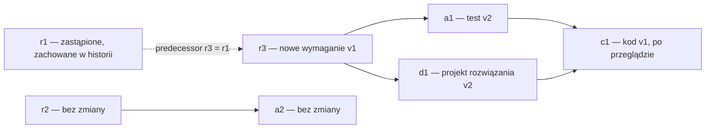

# WIT3: następca wymagania, powiązania i zakres wydania

Status: **proposed**, 2026-10-25. Podstawa: zatwierdzony model **v0.5**, commit `e5fc842b9447e53550aac73f229879bff9d2a850`. Docelowo v0.6 po osobnej decyzji użytkownika. Ten dokument, plan zdarzeń i diagnostyka są materiałem do przeglądu, nie źródłem obowiązujących reguł wykonawcy. Nie zapisano DEC-PRO-009 ani odbioru WIT3/E2.

## Rekomendacja do podpisu

**Zachować zastąpione wymaganie w historii, utworzyć jego następcę jako osobny element, włączyć go do wydania decyzją U, a powiązania aktualizować jawnie tylko w szkicach. Przegląd „bez wpływu” może zamknąć ostrzeżenie dopiero przy dojrzałych, niepodejrzanych zależnościach.**

Praktyczny wynik: operator zobaczy, które testy, projekt rozwiązania i kod wymagają przeglądu po zastąpieniu wymagania. Agent nie będzie mógł ukryć zmiany samym skasowaniem flagi. Jest to rozwinięcie istniejącego WIT3 i E2, bez zmiany kolejności E2–E5.

## 1. Co potwierdzono na obecnym modelu

Odtworzenie: `.venv/bin/python model/proposals/wit3_diagnostics.py` (albo `uv run --locked --offline python model/proposals/wit3_diagnostics.py`). [Zapis wyniku](wit3-diagnostics.json) zawiera hashe modelu i danych. Skrypt jest diagnostyką v0.5; po zmianie wersji należy użyć wskazanego bazowego commitu. Nie modyfikuje plików modelu ani implementacji.

| Obserwacja | Dowód i granica wniosku |
|---|---|
| T07 poprawnie rozpoczyna WIT3 | 28 pierwszych kroków WIT1, P00/P01/P02 i T07: r1 jest superseded, a1/d1/c1 mają suspect, wydanie wraca z reviewed do in_preparation; p1/r2/a2 są identyczne |
| Nie można udawać naprawy bezpośrednich powiązań | T11(a1) jest blokowane przez superseded r1; W01 jest blokowane przez nieprzejrzane zależne |
| Nie ma reprezentacji nowego następcy w instancji | T00(r3) odrzucone jako nieznane ID; wszystkie siedem dotychczasowych ID jest już użytych. W opisie T07 jest nowy element z odwołaniem do starego, lecz brak pola tego odwołania |
| Nie ma operacji aktualizacji grafu i zakresu | Przegląd wszystkich skutków v0.5: żaden nie zmienia depends_on ani scope istniejącego przygotowywanego wydania; W06 tylko kopiuje zakres. To wniosek z reguł, nie z samego błędu T00 |
| T11 może naruszyć S4 | Osiągalny przebieg **30 kroków**, bez wstrzykiwania stanu: pierwsze 28 WIT1 → T06(d1) → T11(c1). Kod c1 pozostaje baselined i bez suspect, choć d1 jest draft. Obecny warunek T11 wyklucza jedynie superseded/withdrawn |
| Proponowane wzmocnienie T11 blokuje ten przypadek | Skrypt zmienia sam warunek na kopii modelu w pamięci; T11 zostaje odrzucone przez guard. Nie jest to dowód wszystkich właściwości nowego modelu |

Brak dalszego WIT3 **nie jest dowodem globalnego zakleszczenia**. Obecny proces dopuszcza np. wycofanie zależnych i odbiór zmniejszonej dostawy. Nie realizowałoby to jednak uzgodnionego WIT3: zastąpienia wymagania, naprawy powiązań i zachowania zależnych produktów.

## 2. Dane i granice instancji

1. Do katalogu `test_instance.items` dołączyć `r3: {type: REQ, depends_on: [p1]}`. Początkowo ma `state=none`, jak inne jeszcze nieutworzone elementy. Początkowy zakres wydania nadal obejmuje wyłącznie dotychczasowych siedem ID. T00, a nie obecność w katalogu, oznacza utworzenie produktu.
2. `depends_on` zadeklarować jako zmienną elementu typu `item_id_set`, inicjalizowaną z `test_instance.items[e.id].depends_on`. Graf roboczy czyta bieżący stan, nie początkową definicję. Typ elementu pozostaje stały. Zbiory są bez duplikatów; serializacja deterministyczna. Pozostałe reguły nie zmieniają tych zbiorów.
3. Dodać `predecessor: {type: optional_item_id, initial: none}`. Ustawiane wyłącznie podczas T00; potem niezmienne. Jest śladem pochodzenia, **nie krawędzią depends_on**: nie uczestniczy w wyliczaniu zależnych i nie wymaga, aby poprzednik pozostawał aktywny.
4. Pozostawić `max_questions=3`, `max_version=3`, `max_releases=2`. Katalog zwiększa granicę liczby produktów z 7 do 8; nie wprowadzać dynamicznej, nieograniczonej alokacji ID. W głównym WIT3 wystarczą 2 pytania, maksymalnie wersja 2 i jedno wydanie.
5. Migawka W04 nadal kopiuje type, depends_on i wszystkie item_variables; obejmie więc również predecessor. Historyczne raporty są wersjonowane w Git; obecne raporty trzeba odtworzyć dla nowego modelu.

WIT1/WIT2/WIT4/WIT5 zachowują zdarzenia i siedmioelementowy zakres. Zmienią się hashe modelu i kształt pełnego stanu: niewykorzystane r3 pozostanie none, poza zakresem. Testy mają nadal wymagać dojrzałości wszystkich siedmiu dotychczasowych produktów, a dodatkowo sprawdzać, że rezerwowego r3 nie utworzono ani nie odebrano. Nie wolno zamienić tej kontroli na ogólne „jakieś elementy są baselined”.

## 3. Dokładne reguły do wdrożenia po zgodzie

### T00 — utworzenie kandydata na następcę

Aktor A, stan none → draft, wersja 1, jak dotychczas. Zdarzenie może podać `predecessor`; brak pola oznacza none. Dla wskazanego poprzednika:

- poprzednik istnieje, ma stan superseded i ten sam typ co nowy element; ID muszą być różne;
- nowy element pochodzi z katalogu instancji, jeszcze nie był utworzony, a jego początkowe zależności są zgodne z definicją typu i nie tworzą cyklu;
- skutkiem jest trwałe zapisanie predecessor wraz z dotychczasowym skutkiem wersji; nie kopiuje się zatwierdzenia, wersji, flag ani zależnych poprzednika;
- T00 nie włącza elementu do wydania i nie zmienia powiązań innych elementów.

Kandydat wymaga zwykłych T01/T02/T04 dla REQ. Samo pochodzenie od r1 nie nadaje uprawnień. WIT3 ma jednego kandydata r3; propozycja nie dodaje automatycznego wyboru „najnowszego następcy” ani globalnej reguły jednego kandydata na zawsze. Jeśli katalog dopuszcza kilku, wybór w W07 i T14 musi wskazywać konkretne ID.

T07 i jego zgoda z DEC-PRO-008 pozostają bez zmiany: zgoda dotyczy zastąpienia starego elementu w podanej wersji. Nie oznacza zatwierdzenia treści przyszłego następcy ani jego zakresu. T00 odmawia predecessor=withdrawn; ten przyrost dotyczy zastępowania, nie przywracania wycofanego produktu.

### W07 include_replacement — jawne włączenie następcy do zakresu

Nowe przejście wydania: aktor **U**, from `[in_preparation]`, to `=`. Zdarzenie wskazuje element `e` (kandydata) oraz demonstracyjny dowód decyzji i cytat w symulacji; w zastosowaniu rzeczywistym dowód zgody operatora.

Warunek:

```text
not in_scope(e)
and e.state = baselined and not e.suspect
and e.predecessor != none
and predecessor(e).state = superseded
and in_scope(predecessor(e))
and forall d in deps(e): in_scope(d)
```

Skutek: `release.scope := release.scope union {e.id}`. Dodanie jest atomowe i nie zmienia stanu wydania, produktów, poprzednika ani wcześniejszych odbiorów. Zdarzenie wskazujące element już w zakresie jest odrzucone.

**Stare r1 pozostaje w zakresie** jako superseded — zgodnie z dotychczasową zasadą zachowania wyłączonych elementów w rekordzie. Zakres oznacza zbiór rozpatrywanych ID, nie listę wyłącznie dostarczanych aktywnych produktów. W07 nie usuwa elementów, nie jest ogólną edycją zakresu i nie działa na reviewed/accepted. Po odbiorze najpierw musi nastąpić przewidziane w modelu W06; W07 może zmienić dopiero nowy rekord in_preparation. W06 nadal kopiuje stary zakres bez zmian.

Dopuszczenie W07 to nowa bramka U w USER_GATES/S1. Włączenie r3 jest osobną decyzją o zakresie — nie ponownym pytaniem o już zatwierdzone T07.

### T14 relink_dependency — naprawa wskazanego powiązania

Nowe przejście elementu: aktor **A**, from `[draft]`, to `draft`. Zdarzenie wskazuje `e`, `old_dependency` i `new_dependency`. Dowód: zapis agenta z odniesieniem do przeglądu, obejmujący e, stare i nowe ID.

Warunki łączne:

- bieżące wydanie ma stan in_preparation, a old_dependency jest bezpośrednią zależnością e;
- stara zależność ma stan superseded; nowa ma `predecessor = old_dependency.id`, jest baselined i bez suspect;
- ID starej i nowej zależności są różne; nowa nie jest już zależnością e; nowa nie jest samym e;
- zastąpienie zachowuje zgodność typów zależności z item_types, bez cykli i duplikatów;
- jeśli e należy do zakresu, nowa zależność też musi do niego należeć. W07 musi więc poprzedzić przepięcie elementów tego wydania.

Skutki atomowe:

```text
e.depends_on := (pre.e.depends_on minus {old_dependency.id}) union {new_dependency.id}
forall d in pre.dependents(e): d.suspect := true
invalidate_release(e)
```

Pozostałe pola e, w tym version, rejections i suspect, bez zmian. T14 nie uznaje elementu za przejrzany i nie zmienia jego stanu dojrzałości. Wersję już zwiększa T05 lub T06 otwierające zmianę zaakceptowanego elementu; edycja szkicu nie zwiększa jej ponownie. Dla nowego szkicu wystarcza T00. Stan draft i późniejsze T01/T02/T04 zapewniają kontrolę treści oraz nowych powiązań. T14 nie zmienia migawki odebranego wydania.

Definicje `deps` i `dependents` muszą korzystać z bieżących depends_on. Dla propagacji w T14 wskazano graf sprzed kroku; żadnego domyślnego przepinania wszystkich zależnych podczas T07.

### T11 — bezpieczne zamknięcie przeglądu bez wpływu

Zachować aktora A, stany źródłowe, skutek i dowód. Zastąpić warunek przez:

```text
suspect and forall d in deps(e): d.state in {approved, baselined} and not d.suspect
```

To celowe wzmocnienie przyjętego modelu: przegląd czeka również na zakończenie przeglądów zależności. Blokuje wykazany kontrprzykład S4 i przedwczesne czyszczenie flag w łańcuchu. T13 pozostaje bez zmian: czyszczenie flagi szkicu nie nadaje dojrzałości, a T01 nadal sprawdza zależności.

## 4. Konkretny przebieg WIT3 po przyjęciu

**54 kroki są planem zdarzeń, nie wynikiem wykonanego v0.6.** [Plan w JSON](wit3-outline.json) wskazuje prefiks i każde dalsze zdarzenie. Główna ścieżka zakłada doprecyzowanie wymagania i testu dla zachowania już realizowanego przez kod. Przegląd c1 „bez wpływu” jest założeniem scenariusza z dowodem demonstracyjnym, nie automatyczną oceną poprawności kodu.

| Kroki | Zdarzenia | Oczekiwany wynik |
|---|---|---|
| 1–28 | Początek WIT1, do W02 | Siedem produktów baselined; wydanie 1 reviewed; rezerwowe r3=none poza zakresem |
| 29–32 | P00/P01/P02(q1: r1 v1, T07), T07(r1,q1) | r1 superseded; a1/d1/c1 suspect; wydanie in_preparation |
| 33–36 | T00(r3, predecessor=r1), T01/T02/T04(r3) | Nowe REQ r3 baselined w wersji 1, zależność od p1; nadal poza zakresem |
| 37 | W07(r3,U) | Zakres ma 8 ID, w tym stare r1 i nowe r3 |
| 38–45 | T12(a1,q2), P01/P02(q2: a1 v1,T05), T05(a1,q2), T14(a1,r1→r3), T01/T02/T04(a1) | a1 baselined v2, depends_on=[r3]; q2 wykorzystane; c1 nadal suspect |
| 46–50 | T06(d1,U), T14(d1,r1→r3), T13(d1), T01/T04(d1) | d1 baselined v2, depends_on=[r3]; c1 nadal suspect |
| 51 | T11(c1,A) z dowodem przeglądu | a1 i d1 są dojrzałe bez suspect; c1 pozostaje baselined v1 i zachowuje depends_on=[d1,a1] |
| 52–54 | W01(A), W02(R), W04(U) | Odbiór tego samego wydania 1, z r3 i nowymi powiązaniami w migawce |

Wyrocznia główna: p1/r2/a2 identyczne przed zmianą i po odbiorze; r1 jest zachowane jako superseded; a1/d1 wskazują r3, c1 nadal a1/d1; wszystkie dostarczane produkty baselined bez suspect; dwa pytania resolved/approved/consumed; current_release=1; brak W06 i odbioru przed ponownym W02. Migawka ma osiem rozpatrywanych ID, w tym wyłączone r1. Reguła complete nadal pozwala na superseded w zakresie.



Strzałki ciągłe pokazują wpływ od zależności do zależnego; depends_on jest zapisane w odwrotnym kierunku. Linia przerywana oznacza historię pochodzenia, nie zależność budowania.

## 5. Kryteria kontroli i mutanty

Nowe propozycje właściwości:

- **S12 — kontrolowana zmiana powiązań:** zmiana depends_on tylko przez T14 na draft, dokładnie jedna wskazana krawędź zastąpiona, zgodny poprzednik/typ, bez cyklu i duplikatu, zależni oznaczeni; predecessor ustawiany w T00 zgodnie z regułą i później niezmienny. Każdy wymieniony warunek dostaje osobny przypadek; mutanty muszą wykazać czułość kontroli zmiany grafu i historii.
- **S13 — kontrolowane rozszerzenie zakresu:** jedyną zmianą scope istniejącego rekordu jest W07 wykonywane przez U w in_preparation, dodające dokładnie wskazanego dojrzałego następcę zgodnie z warunkiem. W04 i W06 zachowują dotychczasową semantykę; stare accepted chroni S10.

| Sprawdzenie | Celowe uszkodzenie, które powinno wykryć |
|---|---|
| T00 z nieznanym/aktywnym poprzednikiem, złym typem, istniejącym nowym ID — odmowa | pominięcie walidacji predecessor albo ponowne użycie ID |
| T14 na verified/approved/baselined bez otwarcia zmiany — odmowa | dopuszczenie baselined w from |
| T14 bez r3 w zakresie albo z innym predecessor — odmowa | usunięcie właściwego warunku |
| T14 do draft/suspect, do siebie, z cyklem albo duplikatem — odmowa | pominięcie dojrzałości lub kontroli grafu; nieosiągalne wejścia strukturalne jawnie oznaczyć jako wstrzyknięte |
| T14 zachowuje pozostałe krawędzie i oznacza c1 | zmiana złej krawędzi / utrata innej krawędzi / pominięcie propagacji |
| T11 nie czyści c1, gdy d1 draft albo suspect | powrót do warunku v0.5 albo usunięcie `not d.suspect` |
| W07 wymaga U, przygotowywanego wydania i właściwego następcy | aktor A, dozwolone reviewed/accepted, usunięcie warunku poprzednika |
| W07 dodaje tylko r3 i zachowuje r1 | usunięcie r1 z zakresu albo dodanie niewskazanego ID |
| Brak możliwości odbioru po T07 bez napraw i nowego W02 | brak invalidate_release, pominięcie pośredniego c1, W04 dopuszczone z ready |
| Błąd i przekroczenie granic nie zostawiają częściowych zmian | kontrolowany błąd po zapisie krawędzi/zakresu; wejście i dowody pozostają niezmienione |
| Zmiana po odbiorze nie edytuje starego zakresu/grafu migawki | alias zakresu/migawki albo W07 dopuszczone na accepted |
| Dotychczasowe WIT nadal przechodzą, rezerwowe r3=none | przypadkowe dodanie r3 do początkowego zakresu lub automatyczne utworzenie |

Kontrole cyklu/typu mogą być redundantne w obecnej hierarchii typów. Próba na celowo błędnym wejściu potwierdza walidację, nie osiągalność takiego stanu procesu; mutanta równoważnego w dopuszczalnej instancji nie wolno zaliczyć jako wykrytego naruszenia procesu.

Testy generowane mają porównywać warunki z osobną wyrocznią, a nie kopiować kod wykonawcy. Wyniki podawać oddzielnie: osiągalne scenariusze, lokalne wstrzyknięcia, liczba wykrytych mutantów, granice. Zaliczenie WIT3 nie oznacza pełnego S1–S13 ani L1–L5. Dodatkowy przebieg może otworzyć zmianę c1 przez trzecie pytanie zamiast T11; mieści się w istniejącym limicie, lecz nie jest warunkiem głównej ścieżki 54 kroków.

## 6. Podstawa i lista wpływu

Sprawdzono lokalną kopię normy: PM.02.02–PM.02.03 (ocena i zatwierdzanie wniosku), SI.03.04–SI.03.05 (aktualizacja i weryfikacja powiązań wymagań z projektem), SI.04.06 (powiązania komponentów i testów). Proponowane pola, warunki, liczba ID i przejścia T14/W07 są **polityką tego modelu**, nie narzuconym przez normę schematem danych. Nie kopiujemy tekstu normy.

Po zgodzie zmiana powinna objąć w jednej edycji:

- `model/process.yaml`: wersja, item_variables (depends_on/predecessor), notacja i inicjalizacja, T00/T11, nowe T14/W07 i ich adnotacje ISO, test_instance z r3. Opis T07 doprecyzować; zgoda, guard i efekty T07 pozostają bez zmian. Frame musi jawnie obejmować graf i zakres.
- `docs/WLASCIWOSCI.md`: USER_GATES z W07, S5 z propagacją T14, nowe S12/S13, przypadki S4/S6, WIT3 i granice ośmiu ID. S10 pozostaje niezmienione. W L5 scope_change uzupełnić o T14 w zakresie i W07, aby warunek ustania zmian uwzględniał nowe kroki. G0/G4/G5/G6 mają objąć nowe dane i przejścia; L1/L3/F1/F3 przejrzeć pod kątem nowych dróg naprawy.
- `docs/INTERPRETACJE.md`: INT-008/012 i nowa interpretacja INT-018 dla jawnego następcy, powiązań oraz rozszerzenia zakresu. INT-017 i niezmienność odbiorów zachowane.
- `PLAN.md`: DoD bezpieczeństwa S1–S13; bez zmiany etapów. `docs/STAN.md`: osobna DEC z dokładnym cytatem, Zmienia i Przejrzane; nowe wyniki, ograniczenia i punkt wznowienia.
- `src/isomodel/loader.py`, `execution.py`, `expressions.py`: inicjalizacja z katalogu, obsługa wejść i skutków, graf roboczy, walidacja, atomowość; nie tworzyć drugiej tabeli semantyki według ID. `graph.py` przejrzeć (graf stanów pozostaje projekcją); analizę aktualnych zależności odróżnić od tej projekcji.
- Testy/fixture WIT3, mutanty, `scripts/check_model.py`, `scripts/run_scenario.py`, raportowanie i przykłady; odtworzyć wszystkie cztery wcześniejsze scenariusze. `scripts/render_process.py` przejrzeć pod kątem nowego T14/W07 i rezerwowego r3. Wskazać, że stare diagramy informative/ są migawką v0.4, bez przepisywania ich historii.

Przejrzane dla propozycji: model i właściwości v0.5, INT-008/012/017, PLAN, karta celu, WSPOLPRACA, STAN, lista kontrolna zmiany w szablonie, wykonawca, interpreter, loader, graf, raportowanie, testy WIT1/WIT5 i pola scenariuszy. Lista wpływu nie jest deklaracją wdrożenia.

## 7. Kolejność i granice realizacji

Po jednej decyzji przyjmującej tę propozycję: zapis decyzji → model i właściwości → czerwone testy → wykonawca → WIT3 i regresja → raport z kryteriami i mutantami → punkt wznowienia. Przegląd niezależny i odbiór etapu pozostają na zakończenie E2. Obecna praca to przygotowanie decyzji, a wykonana diagnostyka bada v0.5.

Nie zmieniać w tym przyroście pustego zakresu W01, nie implementować dynamicznego dodawania dowolnych ID, usuwania elementów, dowolnej edycji zakresu ani ogólnej migracji grafu. W03/W05, pełna maszyna stanów i pozostałe kryteria E2 pozostają w rejestrze prac. Ośmioelementowa instancja daje świadka tej naprawy; nie dowodzi procesu dla dowolnego rozmiaru projektu.

Alternatywy rozważone: automatycznie przepiąć wszystkich zależnych w T07 (ukrywa przegląd i zmianę zaakceptowanych produktów); zmienić r1 w miejscu przez T05 (nie sprawdza zastąpienia); wycofać wszystkie zależne (nie realizuje naprawy z WIT3). Rekomendowany wariant zachowuje historię i rozdziela zgodę na zastąpienie, zatwierdzenie nowego wymagania oraz decyzję o zakresie.
